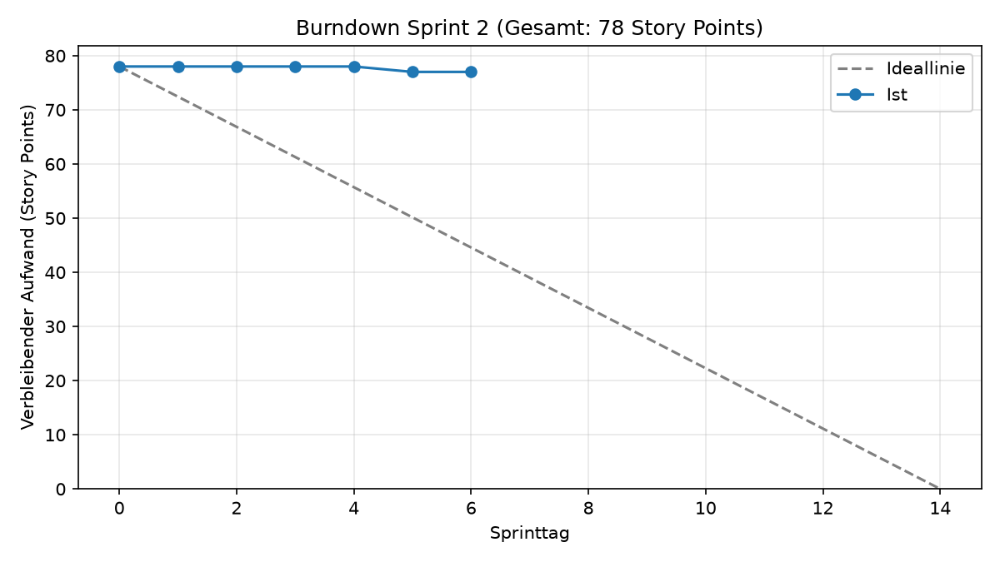

# Cyber Defenders

Lernspiel für Java und IT-Sicherheit

## Team

**FMLD-Studios**

* Felix Hagino ([@FelixHagino](https://github.com/FelixHagino))
* Marco Daquila ([@MarcoDaquila](https://github.com/MarcoDaquila))
* Leonie Röse ([@webdesign19](https://github.com/webdesign19))
* Dominik Stengele ([@keckamreck](https://github.com/keckamreck))

## Links

| Titel | Link |
| ----- | ---- |
| Projekt-Board | https://github.com/orgs/Cyber-Defenders-4/projects/2/views/1 |
| Software Requirements Specification | [docs/SRS.md](docs/SRS.md) |
| Use Cases | [docs/use_cases/](docs/use_cases/) |
| Blog | https://github.com/Cyber-Defenders-4/Cyber-Defenders/discussions |

## Beschreibung

Als Team von **FMLD-Studios** entwickeln wir das Lernspiel **Cyber Defenders**. Dabei wird ein virtueller Escape Room mit einem Detektiv- und Rätselspiel kombiniert.
Die Nutzer lernen darin spielerisch fortgeschrittene Java-Programmierung und grundlegende Prinzipien der IT-Sicherheit.
Gespielt wird in einzelnen Missionen, zum Beispiel in einem gehackten Serverraum oder einem Firmennetzwerk. Zu jeder Mission gibt es eine Fallakte, die Spieler lösen die Rätsel in einem Java-Code-Editor und sehen danach ihren Fortschritt.
Eine Rollenwahl (Cyber-Defender oder White-Hat-Hacker) ist als spätere Erweiterung vorgesehen und gehört nicht zum aktuellen Umfang.

- **Nutzer:** Studierende und Einsteiger, die Java und IT-Sicherheit lernen wollen.
- **Mindestumfang:** eine spielbare Mission mit Code-Editor, automatischer Prüfung der Lösung und gespeichertem Fortschritt.

## Tech-Stack

* Frontend: Angular (TypeScript), Tailwind CSS
* Backend: TypeScript mit Express
* Datenbank: Neon (PostgreSQL)
* Bereitstellung: Vercel

## Lokal starten

## Lokal starten

### Voraussetzungen

- Node.js und npm
- Git

### Repository klonen

```bash
git clone https://github.com/Cyber-Defenders-4/Cyber-Defenders.git
cd Cyber-Defenders
```

### Backend starten

1. In den Backend-Ordner wechseln:

   ```bash
   cd backend
   ```

2. Abhängigkeiten installieren:

   ```bash
   npm install
   ```

3. Entwicklungsserver starten:

   ```bash
   npm run dev
   ```

Das Backend läuft unter `http://localhost:3100`.

Der Health-Check kann über `GET http://localhost:3100/api/status` aufgerufen werden und liefert folgende Antwort:

```json
{
  "status": "ok"
}
```

Für den kompilierten Start stehen außerdem folgende Befehle zur Verfügung:

```bash
npm run build
npm start
```

## Burndown-Chart



Das Chart wird täglich um 21:00 UTC vom Workflow [Burndown](.github/workflows/burndown.yml) aus den Feldern Estimate und Sprint des Projekt-Boards erzeugt. Manuell starten: Tab *Actions* → *Burndown* → *Run workflow*.
