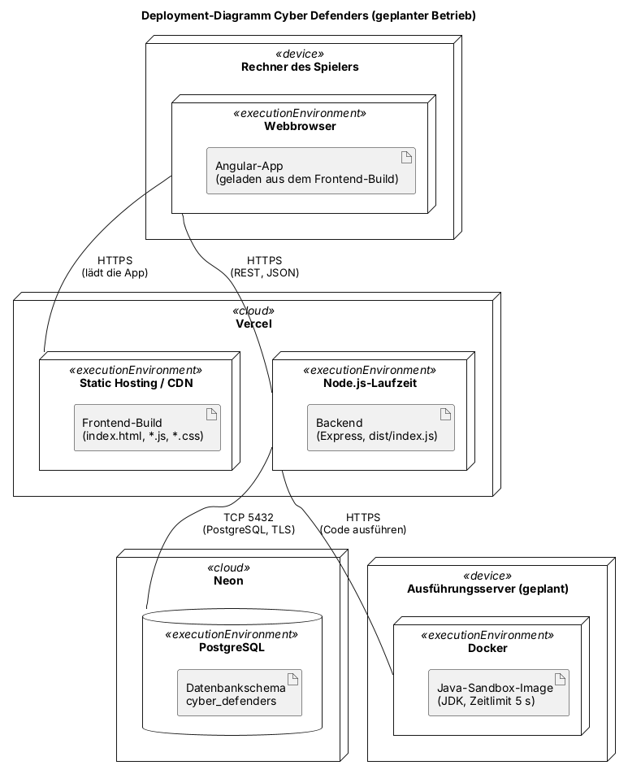
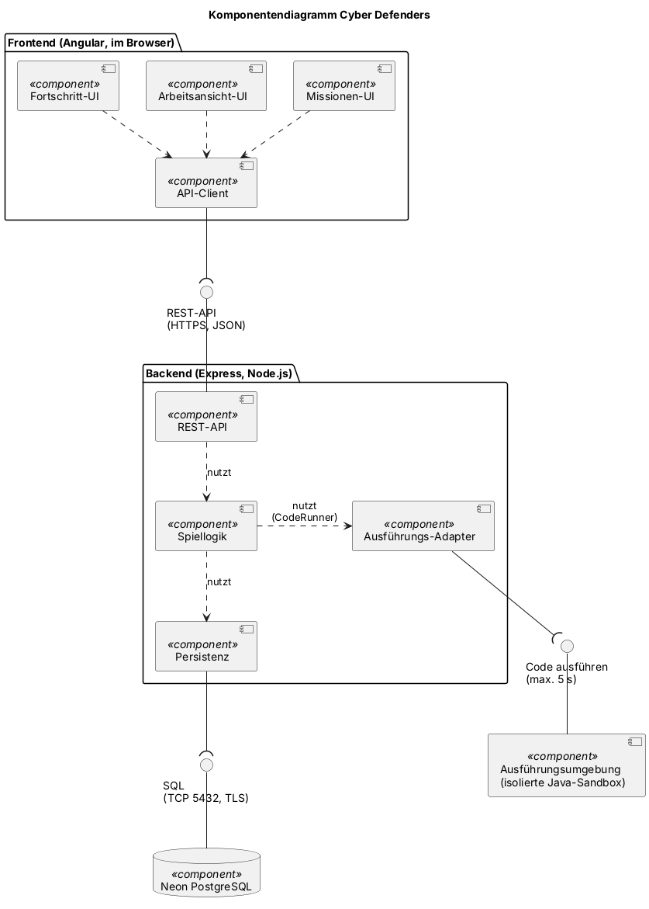

# [Projektname] — Softwarearchitekturdokument

<!--
ANLEITUNG ZUR VERWENDUNG DIESER VORLAGE
- Kopiere diese Datei in den Ordner docs/ deines Repositorys, neben die Datei SRS.md.
- Ersetze jeden [Platzhalter] in eckigen Klammern. Kommentare wie dieser dienen als Anleitung: Sie
  sind auf GitHub unsichtbar und können gelöscht werden, sobald der jeweilige Abschnitt fertig ist.
- Behalte alle Überschriften und ihre Nummerierung bei. Abschnitte, die mit „Vorlesung 7“ oder
  später gekennzeichnet sind, bleiben unverändert, bis die entsprechende Vorlesung stattfindet.
  Falls ein Abschnitt nicht zutrifft, schreibe „Nicht zutreffend“ und begründe dies in einem Satz.
- Gib für jeden von dir verfassten Abschnitt den Autor an: entweder in der Zeile „Autor“ unter der
  Überschrift oder in der Spalte „Autor“ einer Tabelle.
- Lege alle Diagramme im Ordner docs/diagrams/ ab, zusammen mit der jeweiligen Quelldatei.
- Die Struktur folgt der RUP-Vorlage „Software Architecture Document“:
  https://cin.ufpe.br/~if682/RUP/webtmpl/templates/a_and_d/rup_sad.htm
-->

| Team | Version | Letzte Änderung |
| ---- | ------- | --------------- |
| [Teamname] | [0.1] | [TT.MM.JJJJ] |

Die Versionshistorie dieser Datei wird durch die Git-Historie abgebildet.

## Inhaltsverzeichnis

1. [Einleitung](#1-einleitung)
2. [Architekturdarstellung](#2-architekturdarstellung)
3. [Architekturziele und Einschränkungen](#3-architekturziele-und-einschränkungen)
4. [Anwendungsfallsicht](#4-anwendungsfallsicht)
5. [Logische Sicht](#5-logische-sicht)
6. [Prozesssicht](#6-prozesssicht)
7. [Verteilungssicht](#7-verteilungssicht)
8. [Implementierungssicht](#8-implementierungssicht)
9. [Datensicht](#9-datensicht)
10. [Umfang und Leistung](#10-umfang-und-leistung)
11. [Qualität](#11-qualität)

## 1 Einleitung

### 1.1 Zweck

*Autor: [Vorname]*

<!-- Ein Absatz: Was beschreibt dieses Dokument und wer liest es – euer Team,
     Entwickler, die das Projekt übernehmen, und der Dozent als Auftraggeber? -->

Dieses Dokument beschreibt die Architektur von [Projektname]: aus welchen Komponenten die Anwendung besteht, wie diese miteinander verbunden sind und wo sie ausgeführt werden. […]

### 1.2 Umfang

*Autor: [Vorname]*

<!-- Ein oder zwei Sätze: Welche Software wird in diesem Dokument behandelt?
     Beispielsweise die gesamte Anwendung mit Frontend, Backend und Datenbank.
     Der funktionale Umfang ist in Abschnitt 1.2 der SRS beschrieben – verlinke ihn. -->

[…] Der funktionale Umfang ist in [SRS 1.2](SRS.md#12-scope) beschrieben.

### 1.3 Definitionen, Akronyme und Abkürzungen

*Autor: [Vorname]*

<!-- Fachbegriffe aus dem Anwendungsbereich stehen in der SRS und im Domänenmodell.
     Füge nur technische Begriffe hinzu, die Leser dieses Dokuments kennen müssen. -->

| Begriff | Bedeutung |
| ------- | --------- |
| SAD | Softwarearchitekturdokument (Software Architecture Document) |
| SRS | Anforderungsspezifikation (Software Requirements Specification) |
| UCR | Anwendungsfallrealisierung (Use-Case Realization) |
| [Begriff] | [Bedeutung] |

### 1.4 Referenzen

*Autor: [Vorname]*

| Titel | Link |
| ----- | ---- |
| SRS | [SRS.md](SRS.md) |
| Domänenmodell | [domain_model.md](domain_model.md) |
| Repository | [Link] |
| Projektboard | [Link zum GitHub-Projects-Board] |

### 1.5 Überblick

Abschnitt 2 benennt die in diesem Dokument verwendeten Sichten. Die Abschnitte 3 bis 11 beschreiben die Architektur Sicht für Sicht und folgen dabei der RUP-Vorlage.

## 2 Architekturdarstellung

*Autor: [Vorname]*

<!-- Welche Sichten werden verwendet und welches Diagramm stellt die jeweilige Sicht dar?
     Die Tabelle enthält bereits die Sichten aus Vorlesung 6. Passe sie an, wenn du Sichten
     hinzufügst oder entfernst. Spätere Vorlesungen ergänzen hier den Architekturstil und
     die Architekturentscheidungen. -->

| Sicht | Welche Frage beantwortet sie? | Diagramm | Abschnitt |
| ----- | ---------------------------- | -------- | --------- |
| Anwendungsfallsicht | Was macht das System und für wen? | Anwendungsfalldiagramm, Anwendungsfallrealisierungen | 4 |
| Logische Sicht | Welche Klassen gibt es und wie sind sie miteinander verbunden? | Klassendiagramme | 5 |
| Prozesssicht | Was wird gleichzeitig ausgeführt? | Kurzbeschreibung | 6 |
| Verteilungssicht | Was läuft wo und wie ist es verbunden? | Verteilungsdiagramm | 7 |
| Implementierungssicht | Aus welchen Teilen besteht der Code? | Komponentendiagramm, Paketdiagramm | 8 |

## 3 Architekturziele und Einschränkungen

<!-- Vorlesung 7. Anforderungen und Einschränkungen, die eure Architektur beeinflussen:
     Qualitätsziele wie Verfügbarkeit oder Sicherheit sowie Einschränkungen wie euer Tech-Stack
     (SRS 3.6), Teamgröße oder Zeitplan. Bis dahin bleibt dieser Abschnitt unverändert. -->

*Wird in Vorlesung 7 behandelt.*

## 4 Anwendungsfallsicht

*Autor: [Vorname]*

<!-- Die für die Architektur wichtigsten Anwendungsfälle – normalerweise diejenigen,
     die ihr in Aufgabe 4 realisiert habt. Verlinke das Anwendungsfalldiagramm, statt es zu kopieren. -->

Das Anwendungsfalldiagramm der gesamten Anwendung befindet sich in [SRS 2.2](SRS.md#22-use-case-diagram). Die für die Architektur wichtigsten Anwendungsfälle sind: […]

### 4.1 Anwendungsfallrealisierungen

<!-- Eine Zeile pro Realisierung aus Aufgabe 4. Keine neuen Diagramme erstellen:
     Verlinke die vorhandenen Dateien. -->

| Anwendungsfall | Realisierung | Autor |
| -------------- | ------------ | ----- |
| [UC-02 Einen Raum buchen](use_cases/UC-02_[name].md) | [UCR-02](use_case_realizations/UCR-02_[name].md) | [Vorname] |

## 5 Logische Sicht

### 5.1 Überblick

*Autor: Dominik*

<!-- Verlinke euer Domänenmodell aus Aufgabe 5. Falls ihr ein Paketdiagramm habt,
     füge es hier ein: Es zeigt die Pakete eures Codes und ihre Abhängigkeiten,
     die keine Zyklen bilden dürfen. -->

Das Domänenmodell befindet sich in [domain_model.md](domain_model.md). Es zeigt, was die Anwendung speichert: Spieler mit Rang, Missionen mit Fallakte, Beweisdateien, Testfällen und Hinweisen, dazu Missionsfortschritt, Codeentwurf und Erfolge. Ein Paketdiagramm gibt es noch nicht, es folgt, sobald die Ordnerstruktur von Frontend und Backend mit Code gefüllt ist.

### 5.2 Architektonisch relevante Entwurfspakete

*Autor: Dominik*

<!-- Derzeit optional. Verlinke die Entwurfsklassen eurer Anwendungsfallrealisierungen
     (Abschnitt 2.5 der UCR) oder beschreibe eure wichtigsten Pakete jeweils in einem Satz. -->

Die Entwurfsklassen jedes Anwendungsfalls stehen in Abschnitt 2.5 der Realisierung, mit Klassendiagramm und Sequenzdiagramm:

| Realisierung | Wichtigste Entwurfsklassen |
| ------------ | -------------------------- |
| [UCR-01](use_case_realizations/UCR-01_mission_auswaehlen.md) | MissionOverviewComponent, MissionService, MissionRepository, ProgressRepository |
| [UCR-02](use_case_realizations/UCR-02_Fallakte_lesen.md) | CaseFileComponent, WorkspaceComponent, MissionService, EvidenceRepository |
| [UCR-03](use_case_realizations/UCR-03_L%C3%B6sung_im_Editor_schreiben.md) | CodeEditorComponent, DraftService, DraftRepository |
| [UCR-04](use_case_realizations/UCR-04_loesung_pruefen.md) | SubmissionService, CodeRunner, SandboxRunner, TestCaseRepository |
| [UCR-05](use_case_realizations/UCR-05_fortschritt_speichern.md) | CaseSolvedDialogComponent, ProgressService, PlayerRepository, RankRepository |
| [UCR-06](use_case_realizations/UCR-06_fortschritt_ansehen.md) | ProgressOverviewComponent, ProgressService, AchievementRepository |
| [UCR-07](use_case_realizations/UCR-07_hinweis_anfordern.md) | CodeEditorComponent, HintService, HintRepository |
| [UCR-08](use_case_realizations/UCR-08_code_ausfuehren.md) | ConsoleComponent, RunService, CodeRunner, SandboxRunner |

## 6 Prozesssicht

*Autor: [Vorname]*

<!-- Derzeit optional. Ein oder zwei Sätze: Welche Prozesse laufen, beispielsweise das
     Frontend im Browser, das Backend und die Datenbank? Gibt es Hintergrundprozesse,
     etwa einen zeitgesteuerten Job? -->

[…]

## 7 Verteilungssicht

*Autor: [Vorname]*

<!-- Ein UML-Verteilungsdiagramm: Knoten (Geräte, Ausführungsumgebungen), die darauf
     laufenden Artefakte und die Kommunikationsverbindungen einschließlich ihrer Protokolle.
     Stelle die Umgebung dar, die ihr für eure Abschlussdemonstration plant oder aktuell
     verwendet, und gib an, welche Variante gezeigt wird. -->

| Knoten | Was läuft dort? | Verbunden mit |
| ------ | --------------- | ------------- |
| [Server] | [Backend, Datenbank] | [Browser: HTTPS] |

## 8 Implementierungssicht

### 8.1 Überblick

*Autor: Dominik*

<!-- Ein UML-Komponentendiagramm der gesamten Anwendung: Frontend, Backend, Datenbank,
     externe Dienste und die Schnittstellen zwischen ihnen (Kugel = stellt bereit,
     Buchse = benötigt). Zwei bis fünf Komponenten innerhalb des Backends sind eine
     angemessene Größenordnung. -->

| Komponente | Verantwortlichkeit | Klassen (Aufgabe 5) |
| ---------- | ------------------ | ------------------- |
| Missionen-UI | Missionsübersicht und Fallakte anzeigen | MissionOverviewComponent, CaseFileComponent |
| Arbeitsansicht-UI | Code-Editor, Konsole, Hinweise und Dialog „Fall gelöst“ | WorkspaceComponent, CodeEditorComponent, ConsoleComponent, CaseSolvedDialogComponent |
| Fortschritt-UI | Fortschritt, Rang und Erfolge anzeigen | ProgressOverviewComponent |
| API-Client | Ruft die REST-API des Backends auf | MissionApiService, DraftApiService, SubmissionApiService, RunApiService, HintApiService, ProgressApiService |
| REST-API | Nimmt HTTP-Anfragen an und gibt JSON zurück | MissionController, DraftController, SubmissionController, RunController, HintController, ProgressController |
| Spiellogik | Fachliche Abläufe: Missionsstatus, Prüfung, XP und Rang, Hinweise | MissionService, DraftService, SubmissionService, RunService, HintService, ProgressService |
| Persistenz | Liest und schreibt die Daten in der Datenbank | MissionRepository, EvidenceRepository, DraftRepository, TestCaseRepository, HintRepository, ProgressRepository, PlayerRepository, RankRepository, AchievementRepository |
| Ausführungs-Adapter | Schickt Code an die Sandbox und liefert das Ergebnis | CodeRunner (Schnittstelle), SandboxRunner |
| Neon PostgreSQL | Speichert Missionen, Spieler und Fortschritt | — (externer Dienst) |
| Ausführungsumgebung | Übersetzt und führt Java-Code isoliert aus, höchstens 5 s | — (externer Dienst) |

Das Frontend kennt nur die REST-API, das Backend kennt die Datenbank nur über die Persistenz und die Sandbox nur über die Schnittstelle `CodeRunner`. So lässt sich die Sandbox austauschen, ohne die Spiellogik zu ändern.

### 8.2 Schichten

<!-- Vorlesungen 8 und 9. Die Schichten eurer Anwendung und die Regeln für ihre
     Abhängigkeiten. Bis dahin bleibt dieser Abschnitt unverändert. -->

*Wird in Vorlesung 8 und 9 behandelt.*

## 9 Datensicht

<!-- Derzeit optional. Später: das Datenbankschema oder ER-Modell, abgeleitet aus eurem Domänenmodell. -->

*Wird später behandelt.*

## 10 Umfang und Leistung

<!-- Vorlesung 7. Kennzahlen, die eure Architektur beeinflussen, beispielsweise die erwartete
     Anzahl von Benutzern und Daten sowie die Leistungsanforderungen aus SRS 3.4.
     Bis dahin bleibt dieser Abschnitt unverändert. -->

*Wird in Vorlesung 7 behandelt.*

## 11 Qualität

<!-- Vorlesungen 7 bis 9. Wie unterstützt eure Architektur die erforderlichen Qualitätsmerkmale,
     beispielsweise Verfügbarkeit, Sicherheit und Wartbarkeit? Bis dahin bleibt dieser
     Abschnitt unverändert. -->

*Wird in Vorlesung 7 bis 9 behandelt.*