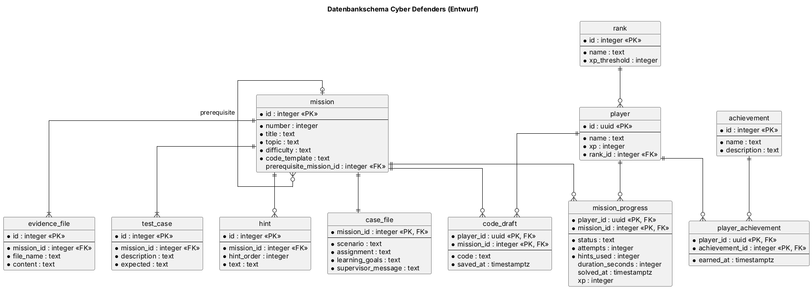

# Cyber Defenders — Software Architecture Document

<!--
HOW TO USE THIS TEMPLATE
- Copy this file into the docs/ folder of your repository, next to SRS.md.
- Replace every [placeholder] in square brackets. Comments like this one are guidance: they
  are invisible on GitHub, and you may delete them once a section is done.
- Keep every heading and its number. Sections marked "Lecture 7" or later stay as they are
  until that lecture. If a section does not apply, write "Not applicable" and one sentence why.
- Every section you write names its author: in the "Author" line below its heading, or in
  the Author column of a table.
- Put every diagram into docs/diagrams/, the image together with its source file.
- Structure after the RUP template "Software Architecture Document":
  https://cin.ufpe.br/~if682/RUP/webtmpl/templates/a_and_d/rup_sad.htm
-->

| Team | Version | Last change |
| ---- | ------- | ----------- |
| FMLD-Studios | 0.1 | 26.10.2026 |

The Git history of this file is the revision history.

## Table of contents

1. [Introduction](#1-introduction)
2. [Architectural representation](#2-architectural-representation)
3. [Architectural goals and constraints](#3-architectural-goals-and-constraints)
4. [Use-case view](#4-use-case-view)
5. [Logical view](#5-logical-view)
6. [Process view](#6-process-view)
7. [Deployment view](#7-deployment-view)
8. [Implementation view](#8-implementation-view)
9. [Data view](#9-data-view)
10. [Size and performance](#10-size-and-performance)
11. [Quality](#11-quality)

## 1 Introduction

### 1.1 Purpose

*Author: Dominik*

Dieses Dokument beschreibt die Architektur von Cyber Defenders: aus welchen Teilen die Anwendung besteht, wie sie zusammenhängen und wo sie laufen. Es richtet sich an unser Team, an alle, die das Projekt später übernehmen, und an den Dozenten in der Rolle des Investors.

### 1.2 Scope

*Author: Dominik*

Das Dokument deckt die gesamte Anwendung ab: das Angular-Frontend im Browser, das Express-Backend, die Datenbank bei Neon und die isolierte Umgebung, in der Java-Code der Spieler ausgeführt wird. Der fachliche Umfang ist in [SRS 1.2](SRS.md#12-umfang-scope) beschrieben.

### 1.3 Definitions, acronyms and abbreviations

*Author: Dominik*

| Term | Meaning |
| ---- | ------- |
| SAD | Software Architecture Document |
| SRS | Software Requirements Specification |
| UCR | Use-case realization |
| REST | Schnittstellenstil zwischen Frontend und Backend: Daten als JSON über HTTPS |
| Sandbox | Isolierte Ausführungsumgebung für den Java-Code der Spieler, mit Zeitlimit von 5 s |
| CDN | Content Delivery Network, liefert die Dateien des Frontends aus |

### 1.4 References

*Author: Dominik*

| Title | Link |
| ----- | ---- |
| SRS | [SRS.md](SRS.md) |
| Domain model | [domain_model.md](domain_model.md) |
| Repository | https://github.com/Cyber-Defenders-4/Cyber-Defenders |
| Board | https://github.com/orgs/Cyber-Defenders-4/projects/2/views/1 |

### 1.5 Overview

Section 2 names the views this document uses. Sections 3 to 11 describe the architecture view
by view, following the RUP template.

## 2 Architectural representation

*Author: Dominik*

| View | Question it answers | Diagram | Section |
| ---- | ------------------- | ------- | ------- |
| Use-case view | What does the system do, and for whom? | Use case diagram, use-case realizations | 4 |
| Logical view | Which classes, and how are they linked? | Class diagrams | 5 |
| Process view | What runs at the same time? | Short description | 6 |
| Deployment view | What runs where, and how is it connected? | Deployment diagram | 7 |
| Implementation view | Which parts is the code made of? | Component diagram | 8 |
| Data view | How are the data stored? | Database schema | 9 |

Alle Diagramme sind mit PlantUML erstellt. Die Quelldateien (`.puml`) liegen neben den Bildern in [diagrams/](diagrams/).

## 3 Architectural goals and constraints

<!-- Lecture 7. The requirements and constraints that shape your architecture: quality goals
     such as availability or security, and constraints such as your stack (SRS 3.6), your team
     size, or your schedule. Leave this section as it is until then. -->

*Follows with Lecture 7.*

## 4 Use-case view

*Author: Dominik*

The use case diagram of the whole application is in [SRS 2.2](SRS.md#22-use-case-diagramm). The
use cases most important for the architecture are UC-04 „Lösung prüfen lassen“ und UC-08 „Code ausführen“, weil sie Nutzer-Code in einer isolierten Sandbox ausführen und dafür eine eigene Komponente und einen eigenen Knoten brauchen, sowie UC-05 „Fortschritt speichern“, weil er den Spielstand dauerhaft in der Datenbank ablegt.

### 4.1 Use-case realizations

| Use case | Realization | Author |
| -------- | ----------- | ------ |
| [UC-01 Mission auswählen](use_cases/UC-01_mission-auswaehlen.md) | [UCR-01](use_case_realizations/UCR-01_mission_auswaehlen.md) | Dominik |
| [UC-02 Fallakte lesen](use_cases/UC-02_fallakte-lesen.md) | [UCR-02](use_case_realizations/UCR-02_Fallakte_lesen.md) | Marco |
| [UC-03 Lösung im Editor schreiben](use_cases/UC-03_loesung-schreiben.md) | [UCR-03](use_case_realizations/UCR-03_L%C3%B6sung_im_Editor_schreiben.md) | Marco |
| [UC-04 Lösung prüfen lassen](use_cases/UC-04_loesung-pruefen.md) | [UCR-04](use_case_realizations/UCR-04_loesung_pruefen.md) | Felix |
| [UC-05 Fortschritt speichern](use_cases/UC-05_fortschritt-speichern.md) | [UCR-05](use_case_realizations/UCR-05_fortschritt_speichern.md) | Felix |
| [UC-06 Fortschritt ansehen](use_cases/UC-06_fortschritt-ansehen.md) | [UCR-06](use_case_realizations/UCR-06_fortschritt_ansehen.md) | Leonie |
| [UC-07 Hinweis anfordern](use_cases/UC-07_hinweis-anfordern.md) | [UCR-07](use_case_realizations/UCR-07_hinweis_anfordern.md) | Leonie |
| [UC-08 Code ausführen](use_cases/UC-08_code-ausfuehren.md) | [UCR-08](use_case_realizations/UCR-08_code_ausfuehren.md) | Leonie |

## 5 Logical view

### 5.1 Overview

*Author: Dominik*

The domain model is in [domain_model.md](domain_model.md). Es zeigt, was die Anwendung speichert: Spieler mit Rang, Missionen mit Fallakte, Beweisdateien, Testfällen und Hinweisen, dazu Missionsfortschritt, Codeentwurf und Erfolge. Ein Paketdiagramm gibt es noch nicht, es folgt, sobald die Ordnerstruktur von Frontend und Backend mit Code gefüllt ist.

### 5.2 Architecturally significant design packages

*Author: Dominik*

Die Designklassen jedes Use Cases stehen in Abschnitt 2.5 der Realisierung, mit Klassendiagramm und Sequenzdiagramm:

| Realization | Most important design classes |
| ----------- | ----------------------------- |
| [UCR-01](use_case_realizations/UCR-01_mission_auswaehlen.md) | MissionOverviewComponent, MissionService, MissionRepository, ProgressRepository |
| [UCR-02](use_case_realizations/UCR-02_Fallakte_lesen.md) | CaseFileComponent, WorkspaceComponent, MissionService, EvidenceRepository |
| [UCR-03](use_case_realizations/UCR-03_L%C3%B6sung_im_Editor_schreiben.md) | CodeEditorComponent, DraftService, DraftRepository |
| [UCR-04](use_case_realizations/UCR-04_loesung_pruefen.md) | SubmissionService, CodeRunner, SandboxRunner, TestCaseRepository |
| [UCR-05](use_case_realizations/UCR-05_fortschritt_speichern.md) | CaseSolvedDialogComponent, ProgressService, PlayerRepository, RankRepository |
| [UCR-06](use_case_realizations/UCR-06_fortschritt_ansehen.md) | ProgressOverviewComponent, ProgressService, AchievementRepository |
| [UCR-07](use_case_realizations/UCR-07_hinweis_anfordern.md) | CodeEditorComponent, HintService, HintRepository |
| [UCR-08](use_case_realizations/UCR-08_code_ausfuehren.md) | ConsoleComponent, RunService, CodeRunner, SandboxRunner |

## 6 Process view

*Author: Dominik*

Zur Laufzeit gibt es vier Prozesse: die Angular-App im Browser des Spielers, der Node.js-Prozess mit dem Express-Backend, der Datenbankserver bei Neon und je Ausführung von Spieler-Code ein kurzlebiger Prozess in der Sandbox. Das Backend startet diesen Sandbox-Prozess für jeden Probelauf (UC-08) und jede Prüfung (UC-04) neu und beendet ihn spätestens nach 5 s (NFR-P-01). Im Hintergrund erzeugt außerdem eine GitHub Action täglich das Burndown-Chart, sie gehört aber nicht zur Anwendung.

## 7 Deployment view

*Author: Dominik*

Das Diagramm zeigt den geplanten Betrieb für die Abschlussdemo.

| Node | What runs there | Connected to |
| ---- | --------------- | ------------ |
| Rechner des Spielers (Webbrowser) | Angular-App | Vercel CDN: HTTPS, Node.js-Laufzeit: HTTPS (REST, JSON) |
| Vercel, Static Hosting / CDN | Frontend-Build (`index.html`, JavaScript, CSS) | Browser: HTTPS |
| Vercel, Node.js-Laufzeit | Backend (Express) | Browser: HTTPS, Neon: TCP 5432 (TLS), Ausführungsserver: HTTPS |
| Neon (PostgreSQL) | Datenbankschema `cyber_defenders` | Backend: TCP 5432 (TLS) |
| Ausführungsserver mit Docker (geplant) | Java-Sandbox-Image mit JDK | Backend: HTTPS |

Frontend und Backend laufen bei Vercel (SRS 3.6, DC-04), die Datenbank als eigener Knoten bei Neon (DC-03). Wo die Sandbox läuft, ist noch offen: Vercel kann keine Docker-Container ausführen, deshalb ist sie als eigener Server mit Docker eingezeichnet.

Heute läuft die Anwendung lokal auf den Rechnern im Team: das Frontend mit `ng serve` auf Port 4100, das Backend mit `npm run dev` auf Port 3100 (siehe [README](../README.md)). Datenbank und Sandbox sind noch nicht angebunden.

## 8 Implementation view

### 8.1 Overview

*Author: Dominik*

| Component | Responsibility | Classes (Task 5) |
| --------- | -------------- | ---------------- |
| Missionen-UI | Missionsübersicht und Fallakte anzeigen | MissionOverviewComponent, CaseFileComponent |
| Arbeitsansicht-UI | Code-Editor, Konsole, Hinweise und Dialog „Fall gelöst“ | WorkspaceComponent, CodeEditorComponent, ConsoleComponent, CaseSolvedDialogComponent |
| Fortschritt-UI | Fortschritt, Rang und Erfolge anzeigen | ProgressOverviewComponent |
| API-Client | Ruft die REST-API des Backends auf | MissionApiService, DraftApiService, SubmissionApiService, RunApiService, HintApiService, ProgressApiService |
| REST-API | Nimmt HTTP-Anfragen an und gibt JSON zurück | MissionController, DraftController, SubmissionController, RunController, HintController, ProgressController |
| Spiellogik | Fachliche Abläufe: Missionsstatus, Prüfung, XP und Rang, Hinweise | MissionService, DraftService, SubmissionService, RunService, HintService, ProgressService |
| Persistenz | Liest und schreibt die Daten in der Datenbank | MissionRepository, EvidenceRepository, DraftRepository, TestCaseRepository, HintRepository, ProgressRepository, PlayerRepository, RankRepository, AchievementRepository |
| Ausführungs-Adapter | Schickt Code an die Sandbox und liefert das Ergebnis | CodeRunner (Schnittstelle), SandboxRunner |
| Neon PostgreSQL | Speichert Missionen, Spieler und Fortschritt | — (externer Dienst) |
| Ausführungsumgebung | Übersetzt und führt Java-Code isoliert aus, höchstens 5 s | — (externer Dienst) |

Das Frontend kennt nur die REST-API, das Backend kennt die Datenbank nur über die Persistenz und die Sandbox nur über die Schnittstelle `CodeRunner`. So lässt sich die Sandbox austauschen, ohne die Spiellogik zu ändern.

### 8.2 Layers

<!-- Lectures 8 and 9. The layers of your application and the rules between them. Leave this
     section as it is until then. -->

*Follows with Lectures 8 and 9.*

## 9 Data view

*Author: Dominik*

Das Datenbankschema leitet sich aus dem Domänenmodell ab: Jede Klasse wird zu einer Tabelle mit technischem Primärschlüssel, die Beziehungen werden zu Fremdschlüsseln, und die Beziehung zwischen Spieler und Erfolg wird über die Tabelle `player_achievement` abgebildet. Das Schema ist ein Entwurf und wird bei der Anbindung von Neon umgesetzt.

## 10 Size and performance

<!-- Lecture 7. The numbers that shape your architecture, e.g., expected users and data, and
     your performance requirements from SRS 3.4. Leave this section as it is until then. -->

*Follows with Lecture 7.*

## 11 Quality

<!-- Lectures 7 to 9. How your architecture supports the qualities you need: availability,
     security, maintainability, … Leave this section as it is until then. -->

*Follows with Lectures 7 to 9.*
