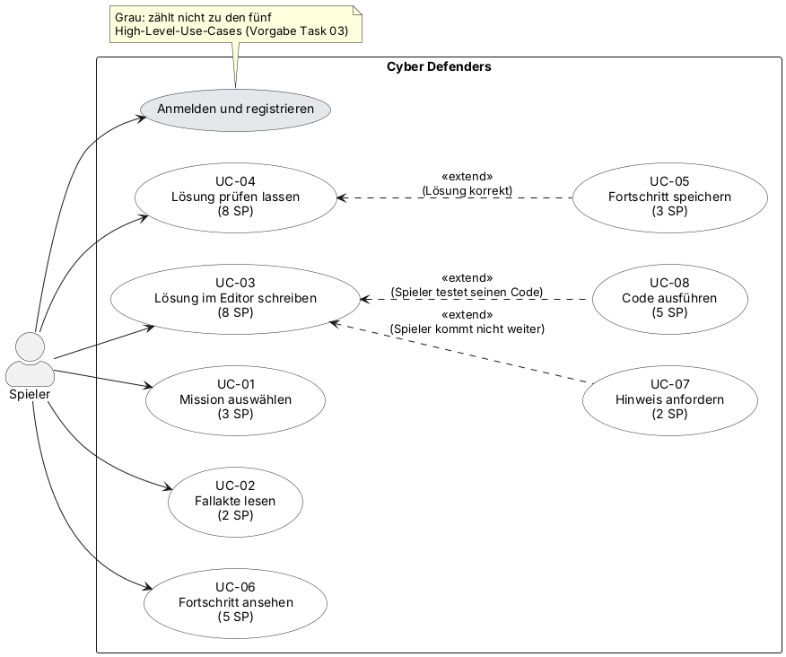

# Cyber Defenders — Software Requirements Specification

<!--
SO NUTZT IHR DIESE VORLAGE
- Kopiert den ganzen docs/-Ordner in euer Repository.
- Ersetzt jeden [Platzhalter] in eckigen Klammern. Kommentare wie dieser sind Hinweise: Sie
  sind auf GitHub unsichtbar und können gelöscht werden, sobald ein Abschnitt fertig ist.
- Behaltet jede Überschrift und ihre Nummer. Wenn ein Abschnitt nicht zutrifft, schreibt
  "Nicht zutreffend" und einen Satz mit der Begründung.
- Jeder Abschnitt, den ihr schreibt, nennt seinen Autor: in der Zeile "Autor" unter der
  Überschrift oder in der Spalte "Autor" einer Tabelle. Vorausgefüllte Abschnitte brauchen
  keinen Autor.
- Aufbau nach der RUP-Vorlage "Software Requirements Specification":
  https://cin.ufpe.br/~if682/RUP/webtmpl/templates/req/rup_srs.htm
-->

| Team | Version | Letzte Änderung |
| ---- | ------- | --------------- |
| FMLD-Studios | 0.1 | 12.10.2026 |

Die Git-Historie dieser Datei ist die Änderungshistorie.

## Inhaltsverzeichnis

1. [Einleitung](#1-einleitung)
2. [Allgemeine Beschreibung](#2-allgemeine-beschreibung)
3. [Spezifische Anforderungen](#3-spezifische-anforderungen)
4. [Ergänzende Informationen](#4-ergänzende-informationen)

## 1 Einleitung

### 1.1 Zweck

*Autor: [Vorname]*

<!-- Ein Absatz: Was beschreibt dieses Dokument, und wer liest es
     (euer Team, der Dozent als Investor, die Person, die das Projekt übernimmt)? -->

Dieses Dokument spezifiziert die Anforderungen an Cyber Defenders, ein Lernspiel für Java und IT-Sicherheit. Es richtet sich an unser Team, an den Dozenten in der Rolle des Investors und an alle, die das Projekt später weiterentwickeln.

### 1.2 Umfang (Scope)

*Autor: [Vorname]*

<!-- Was die Software tut und für wen, in zwei bis drei Sätzen.
     Danach eine ausdrückliche Trennung in "im Umfang" und "nicht im Umfang", jeweils mit
     Begründung. Nicht im Umfang = euer MoSCoW-"Won't have this time". Spätere Änderungen
     dokumentiert ihr hier. -->

Cyber Defenders ist ein webbasiertes Lernspiel für Studierende und Einsteiger. Spieler wählen eine Rolle (Cyber-Defender oder White-Hat-Hacker), lösen in einzelnen Missionen Rätsel zu Java und IT-Sicherheit und sehen ihren Fortschritt. Der Fortschritt wird dauerhaft gespeichert.

| Im Umfang | Begründung |
| --------- | ---------- |
| Rolle auswählen (Cyber-Defender oder White-Hat-Hacker) | Grundlage des Spielkonzepts: IT-Sicherheit aus zwei Blickwinkeln lernen |
| Missionen anzeigen, auswählen und starten (Fallakte mit Schwierigkeitsgrad, Auftrag und Lernzielen) | Mindestumfang aus unserer Vision: mindestens eine spielbare Mission |
| Java-Code-Editor mit automatischer Prüfung der Lösung | Teil des Mindestumfangs aus Task 1 [Umfang nach der Entscheidung zum Feedback zu Task 1 anpassen] |
| Fortschritt, Level und Punkte speichern und einsehen | Mindestumfang aus unserer Vision, die Anwendung muss Daten dauerhaft speichern |
| Missionen und Rätsel verwalten (neue Missionen anlegen) | In Task 1 als Use Case genannt, wird in späteren Sprints spezifiziert |

| Nicht im Umfang | Begründung |
| --------------- | ---------- |
| [Funktion, z. B. echte Ausführung von Nutzer-Code im Backend, noch zu entscheiden] | [Grund, z. B. Aufwand und Sicherheit (abgesicherte Ausführung)] |

### 1.3 Definitionen, Akronyme und Abkürzungen

*Autor: [Vorname]*

| Begriff | Bedeutung |
| ------- | --------- |
| SRS | Software Requirements Specification (Software-Anforderungsspezifikation) |
| UC | Use Case (Anwendungsfall) |
| NFR | Nicht-funktionale Anforderung (Qualitätsanforderung oder Randbedingung) |
| MVP | Minimum Viable Product, die kleinste spielbare Version |
| Mission | Ein einzelner Spielabschnitt, zum Beispiel „Gehackter Serverraum“, mit Fallakte und Rätseln |
| Fallakte | Beschreibung einer Mission mit Schwierigkeitsgrad, Auftrag und Lernzielen |
| Cyber-Defender, White-Hat-Hacker | Die beiden wählbaren Rollen, aus deren Sicht der Spieler IT-Sicherheit lernt |
| Agent | Bezeichnung für den Spieler in unseren User Stories |

### 1.4 Referenzen

*Autor: [Vorname]*

| Titel | Link |
| ----- | ---- |
| Blog | https://github.com/MarcoDaquila/Cyber-Defenders/discussions |
| Board | https://github.com/users/MarcoDaquila/projects/3/views/1 |
| Repository | https://github.com/MarcoDaquila/Cyber-Defenders |

### 1.5 Überblick

Abschnitt 2 beschreibt das Produkt als Ganzes: Vision und Use-Case-Diagramm. Abschnitt 3 listet die spezifischen Anforderungen auf: die Use Cases (3.1) sowie die Qualitätsanforderungen und Randbedingungen (3.2 bis 3.12).

## 2 Allgemeine Beschreibung

### 2.1 Vision

*Autor: [Vorname]*

<!-- Unsere Vision aus Task 1: Problem, Zielgruppe und Stakeholder,
     der Nutzen und die Abgrenzung zu Alternativen. Der Investor soll sie in zwei Minuten
     verstehen. -->

Cyber Defenders ist ein Lernspiel, das einen virtuellen Escape Room mit einem Detektiv- und Rätselspiel verbindet. In einzelnen Missionen, zum Beispiel in einem gehackten Serverraum oder einem Firmennetzwerk, lernen Spieler spielerisch fortgeschrittene Java-Programmierung und grundlegende Prinzipien der IT-Sicherheit. Vor dem Start wählen sie eine Rolle (Cyber-Defender oder White-Hat-Hacker) und lernen IT-Sicherheit so aus zwei Blickwinkeln. Die Oberfläche folgt einem Retro-PC-Design mit eigenem Maskottchen.

- **Zielgruppe:** Studierende und Einsteiger, die Java und IT-Sicherheit lernen wollen.
- **Stakeholder:** Spieler (Lernende), unser Entwicklungsteam, der Dozent als Investor.
- **Nutzen:** Spielerisches Lernen von Java und IT-Sicherheit anhand praktischer Aufgaben.
- **Abgrenzung zu Alternativen:** [ergänzen, z. B. gegenüber reinen Lernplattformen oder Capture-the-Flag-Angeboten]

### 2.2 Use-Case-Diagramm

*Autor: [Vorname]*

<!-- Ein UML-Use-Case-Diagramm für die gesamte Anwendung mit mindestens fünf übergeordneten
     Use Cases; Login und Registrierung zählen nicht. Legt die Quelldatei neben das Bild. -->

### 2.3 Annahmen und Abhängigkeiten

*Autor: [Vorname]*

<!-- Optional: Was ihr annehmt (z. B. Nutzer haben ein DHBW-Konto) und wovon ihr abhängt
     (z. B. eine externe API). Löscht den Kommentar und schreibt "Keine", falls es nichts gibt. -->

Wir nutzen Neon (PostgreSQL) als gehostete Datenbank und sind damit von diesem Dienst abhängig. [Weitere Annahmen und Abhängigkeiten ergänzen.]

## 3 Spezifische Anforderungen

### 3.1 Funktionalität

<!-- Ein Unterabschnitt pro Use Case. Die Spezifikation liegt in einer eigenen Datei in
     use_cases/, erstellt aus UC-00_template.md. Hier: Name, Autor, ein Satz, Link.
     Task 3: mindestens ein spezifizierter Use Case pro Teammitglied (vier Einträge mit Link).
     Listet jeden Use Case eures Diagramms auf; markiert noch nicht spezifizierte als "geplant". -->

#### 3.1.1 UC-01 Rolle auswählen

*Autor: [Vorname]* · Der Spieler sieht Avatar und Kurzbeschreibung einer Rolle, wählt sie aus und bestätigt die Auswahl für den weiteren Spielverlauf. · Stories: #8 · [Spezifikation](use_cases/UC-01_Rolle-auswaehlen.md)

#### 3.1.2 UC-02 Mission auswählen

*Autor: [Vorname]* · Der Spieler öffnet die Missionsübersicht mit Nummer, Name und Thema jeder Mission und wählt eine Mission aus. · Stories: #12, #13 · [Spezifikation](use_cases/UC-02_Mission-auswaehlen.md)

#### 3.1.3 UC-03 Mission starten

*Autor: [Vorname]* · Der Spieler sieht die Fallakte der gewählten Mission und startet sie, danach öffnet sich die Arbeitsansicht. · Stories: #14, #10 · [Spezifikation](use_cases/UC-03_Mission-starten.md)

#### 3.1.4 UC-04 Rätsel lösen

*Autor: [Vorname]* · Der Spieler löst ein Java-Rätsel der Mission im integrierten Editor und erhält eine Rückmeldung zur Lösung. · Stories: [Issue-Nummern] · [Spezifikation](use_cases/UC-04_Raetsel-loesen.md)

#### 3.1.5 UC-05 Fortschritt einsehen

*Autor: [Vorname]* · Der Spieler sieht seinen Fortschritt, sein Level und seine Punkte. · Stories: [Issue-Nummern] · geplant

#### 3.1.6 UC-06 Missionen verwalten

*Autor: [Vorname]* · Ein Autor legt neue Missionen und Rätsel an und pflegt die Level-Struktur. · Stories: [Issue-Nummern] · geplant

<!-- QUALITÄTSANFORDERUNGEN (3.2 bis 3.5)
     Mindestens eine pro Abschnitt. Jede mit ID, einem Satz mit "soll", einer Zahl, die man
     testen kann, und wenn möglich Stimulus, Reaktion und Messgröße. IDs sind im gesamten SRS
     eindeutig, auch gegenüber den besonderen Anforderungen eurer Use Cases.
     Beispiel: NFR-P-01 — Wenn 50 Nutzer gleichzeitig suchen, listet die App freie Termine
     bei 95 % der Anfragen innerhalb von 1 s auf. -->

### 3.2 Benutzbarkeit

| ID | Anforderung | Autor |
| -- | ----------- | ----- |
| NFR-U-01 | [messbare Anforderung] | [Vorname] |

### 3.3 Zuverlässigkeit

| ID | Anforderung | Autor |
| -- | ----------- | ----- |
| NFR-R-01 | [messbare Anforderung] | [Vorname] |

### 3.4 Leistung

| ID | Anforderung | Autor |
| -- | ----------- | ----- |
| NFR-P-01 | [messbare Anforderung] | [Vorname] |

### 3.5 Wartbarkeit und Erweiterbarkeit

| ID | Anforderung | Autor |
| -- | ----------- | ----- |
| NFR-S-01 | [messbare Anforderung] | [Vorname] |

### 3.6 Entwurfsrandbedingungen

*Autor: [Vorname]*

<!-- Feststehende Entscheidungen, nicht pro Funktion gewählt: euer Stack. -->

| ID | Randbedingung |
| -- | ------------- |
| DC-01 | Frontend: TypeScript mit Angular und Tailwind CSS |
| DC-02 | Backend: TypeScript mit Express |
| DC-03 | Datenbank: Neon (PostgreSQL) |
| DC-04 | Bereitstellung: Docker |

### 3.7 Anforderungen an Online-Benutzerdokumentation und Hilfesystem

Nicht zutreffend. [Begründung, oder durch Anforderungen ersetzen.]

### 3.8 Zugekaufte Komponenten

Nicht zutreffend. [Begründung, oder die Komponenten auflisten.]

### 3.9 Schnittstellen

*Autor: [Vorname]*

#### 3.9.1 Benutzerschnittstellen

<!-- Verlinkt die Mockups eurer Use Cases oder beschreibt die Hauptansichten in je einer Zeile. -->

Alle Ansichten folgen dem Retro-PC-Design. Die Mockups liegen in `mockups/`. [Links zu den Mockups ergänzen]

- **Rollenauswahl:** Avatar und Kurzbeschreibung der Rollen, Auswahl und Bestätigung.
- **Missionsübersicht:** Liste der Missionen mit Nummer, Name und Thema.
- **Fallakte:** Schwierigkeitsgrad, Auftrag und Lernziele der gewählten Mission mit dem Button „Mission starten“.
- **Arbeitsansicht:** Fenster für Beweise (z. B. `server_log.txt`), Einsatzbericht, Java-Code-Editor und Konsole.

#### 3.9.2 Hardwareschnittstellen

Nicht zutreffend. Die Anwendung läuft im Webbrowser und nutzt keine eigene Hardwareschnittstelle.

#### 3.9.3 Softwareschnittstellen

<!-- Externe Dienste und APIs, die ihr nutzt, z. B. ein E-Mail-Dienst. -->

Das Backend (Express) greift auf die Datenbank bei Neon (PostgreSQL) zu. [Weitere externe Dienste ergänzen, falls vorhanden.]

#### 3.9.4 Kommunikationsschnittstellen

<!-- Z. B. HTTPS zwischen Frontend und Backend. -->

Das Frontend (Angular) kommuniziert mit dem Backend (Express) über HTTP(S). Lokal laufen das Frontend auf Port 4100 und das Backend auf Port 3100. [Format der Schnittstelle bestätigen, z. B. REST mit JSON]

### 3.10 Lizenzanforderungen

*Autor: [Vorname]*

<!-- Die Lizenz eures Projekts und die von Bibliotheken, die Bedingungen stellen. -->

[…]

### 3.11 Rechtliche Hinweise, Urheberrecht und sonstige Vermerke

*Autor: [Vorname]*

<!-- Z. B. Datenschutz (DSGVO), wenn ihr personenbezogene Daten speichert. -->

[…]

### 3.12 Anwendbare Standards

*Autor: [Vorname]*

<!-- Z. B. WCAG 2.2 Stufe AA, ein Coding-Standard. -->

[…]

## 4 Ergänzende Informationen

<!-- Optional: Anhänge, Erweiterungen des Glossars, Interviewnotizen. -->

Keine.