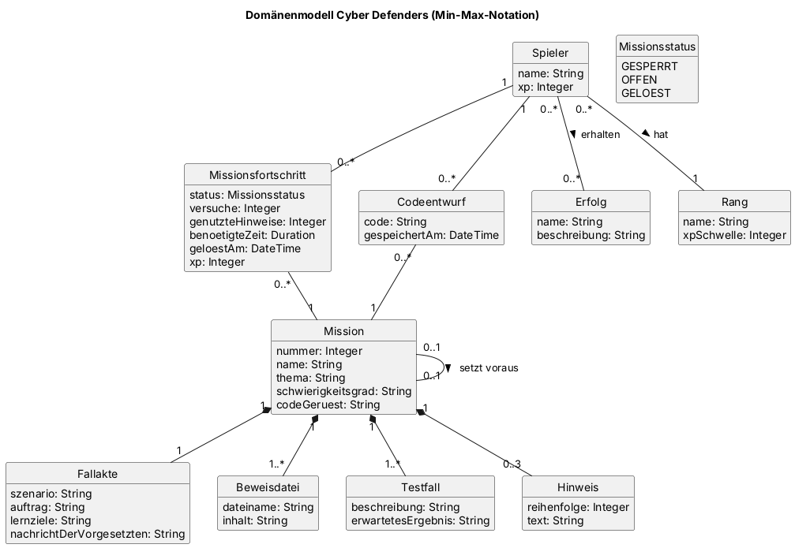

# Domänenmodell

| Autoren | Dominik |
| ------- | ------- |

<!-- Entwurf: Bitte prüft, ob die Entitäten eurer Realisierungen enthalten sind, und tragt euch als Autoren ein. -->

Das Domänenmodell gibt es in zwei Varianten, die sich nur in der Schreibweise der Multiplizitäten unterscheiden.

### Chen-Notation

Multiplizitäten als 1, n und m.

### Min-Max-Notation

Multiplizitäten mit Unter- und Obergrenze, zum Beispiel 0..* oder 0..3. Diese Variante zeigt zusätzlich, dass eine Mission höchstens drei Hinweise hat und dass die erste Mission keine andere voraussetzt.

## Klassen

| Klasse | Bedeutung |
| ------ | --------- |
| Spieler | Person, die das Spiel spielt (in den User Stories „Agent“), mit ihren gesammelten XP |
| Rang | Stufe, die ein Spieler ab einer bestimmten Zahl XP erreicht |
| Mission | Ein Spielabschnitt, zum Beispiel „Gehackter Serverraum“, mit Nummer, Thema, Schwierigkeitsgrad und dem Code-Gerüst für den Editor. Eine Mission kann eine andere voraussetzen, die zuerst gelöst sein muss |
| Fallakte | Beschreibung einer Mission mit Szenario, Auftrag, Lernzielen und Nachricht der Vorgesetzten |
| Beweisdatei | Datei, die der Spieler in einer Mission untersucht, zum Beispiel `server_log.txt` |
| Testfall | Test, gegen den eine eingereichte Lösung geprüft wird, mit erwartetem Ergebnis |
| Hinweis | Einer von höchstens drei Hinweisen pro Mission, in fester Reihenfolge |
| Missionsfortschritt | Stand eines Spielers in einer Mission: Status, Versuche, genutzte Hinweise, benötigte Zeit, Zeitpunkt der Lösung und erhaltene XP |
| Codeentwurf | Zwischengespeicherter Code eines Spielers zu einer Mission |
| Erfolg | Auszeichnung, die ein Spieler für bestimmte Leistungen erhält |
| Missionsstatus | Aufzählung: gesperrt, offen (freigeschaltet) oder gelöst |
