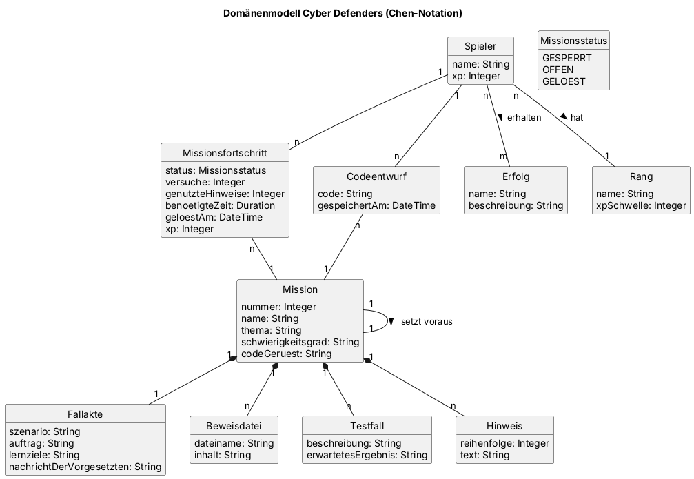

# Domänenmodell

| Autoren | [Vornamen] |
| ------- | ---------- |

<!-- UML-Klassendiagramm der gesamten Anwendung.
     Die Quelldatei neben dem Bild versionieren. -->

## Klassen

| Klasse | Bedeutung |
| ------ | --------- |
| [Klassenname] | [Beschreibung der fachlichen Bedeutung] |