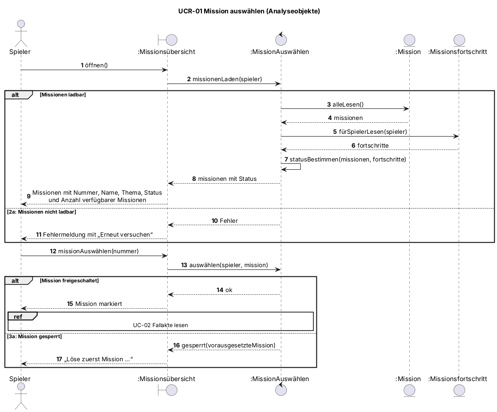
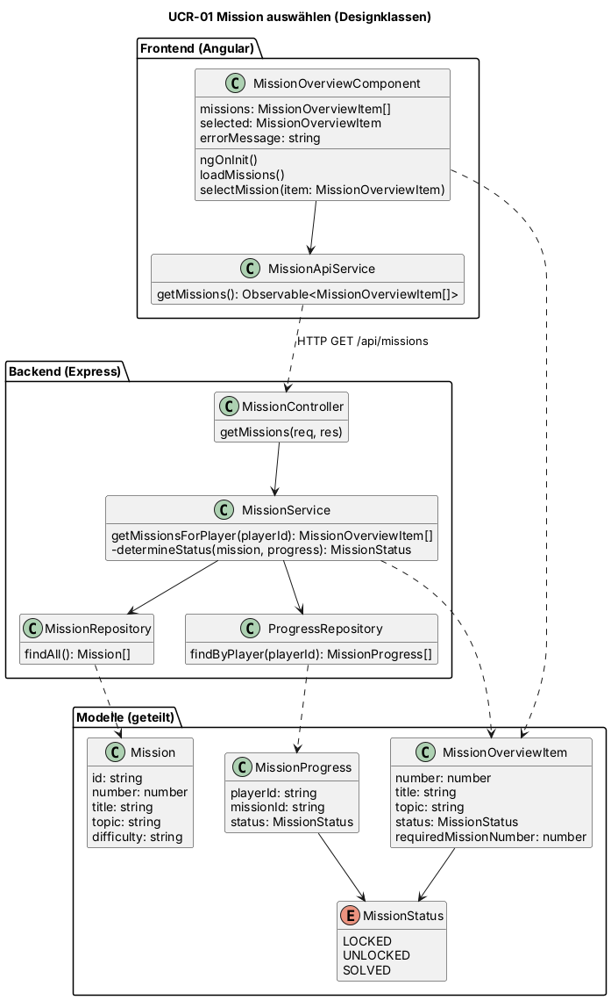
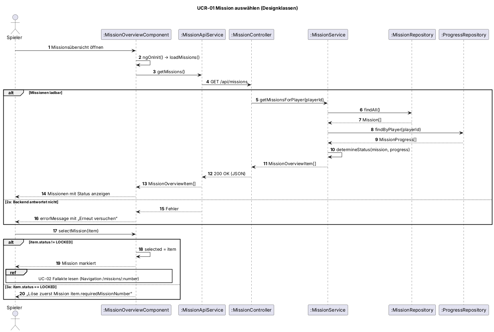

# UCR-01 Mission auswählen — Use-Case-Realisierung

| Autor | Realisiert |
| ------ | ---------- |
| Dominik | [UC-01 Mission auswählen](../use_cases/UC-01_mission-auswaehlen.md) |

## 1 Einleitung

Diese Realisierung beschreibt, welche Objekte UC-01 „Mission auswählen“ umsetzen: Der Spieler öffnet die Missionsübersicht, das System lädt die Missionen mit dem Fortschritt des Spielers und bestimmt für jede Mission den Status. Abgedeckt sind der Basic Flow sowie die Alternativen 2a (Missionen nicht ladbar) und 3a (gesperrte Mission gewählt). Das Anzeigen der Fallakte nach der Auswahl gehört zu UC-02 und ist hier nur als Verweis enthalten.

## 2 Ablauf der Ereignisse — Entwurf

### 2.1 Beteiligte Objekte

| Objekt | Stereotyp | Verantwortlichkeit |
| ------ | --------- | ------------------ |
| :Missionsübersicht | boundary | Zeigt dem Spieler die Missionen mit Status an und nimmt seine Auswahl entgegen |
| :MissionAuswählen | control | Lädt Missionen und Fortschritt, bestimmt den Status jeder Mission und prüft, ob die gewählte Mission freigeschaltet ist |
| :Mission | entity | Speichert Nummer, Name, Thema und Schwierigkeitsgrad einer Mission sowie die Mission, die vorher gelöst sein muss |
| :Missionsfortschritt | entity | Speichert, welche Missionen ein Spieler bereits gelöst hat |

### 2.2 Sequenzdiagramme

### 2.3 Ablaufbeschreibung

Der Spieler öffnet die Missionsübersicht (Schritt 1). Die Boundary `:Missionsübersicht` gibt den Auftrag an die Control `:MissionAuswählen` weiter, die alle Missionen aus `:Mission` und den Fortschritt des Spielers aus `:Missionsfortschritt` liest. Aus beidem bestimmt sie für jede Mission den Status freigeschaltet, gesperrt oder gelöst und gibt die Liste an die Boundary zurück, die sie anzeigt (Schritt 2). Lässt sich nichts laden, zeigt die Boundary eine Fehlermeldung mit „Erneut versuchen“ (2a).

Wählt der Spieler eine Mission (Schritt 3), prüft `:MissionAuswählen`, ob sie freigeschaltet ist. Ist sie es, wird sie markiert und die Fallakte geöffnet (Schritt 4, weiter in UC-02). Ist sie gesperrt, liefert die Control die Mission, die zuerst gelöst werden muss, und die Boundary zeigt den Hinweis an (3a).

### 2.4 Zustandsautomat

Nicht zutreffend. Der Status einer Mission (gesperrt, freigeschaltet, gelöst) wird in diesem Use Case nur gelesen. Er ändert sich in UC-05 „Fortschritt speichern“, der Zustandsautomat gehört deshalb dorthin.

### 2.5 Designklassen

| Analyseobjekt (2.1) | Designklasse(n) |
| ------------------- | ---------------- |
| :Missionsübersicht «boundary» | MissionOverviewComponent, MissionApiService (Frontend), MissionController (Backend) |
| :MissionAuswählen «control» | MissionService |
| :Mission «entity» | Mission, MissionRepository |
| :Missionsfortschritt «entity» | MissionProgress, ProgressRepository, MissionStatus |

Die Prüfung, ob die gewählte Mission freigeschaltet ist, übernimmt im Design die `MissionOverviewComponent`: Der `MissionService` liefert jede Mission bereits mit Status und der vorausgesetzten Mission (`MissionOverviewItem`), sodass für die Auswahl kein weiterer Aufruf ans Backend nötig ist.

## 3 Abgeleitete Anforderungen

- DR-01-01 — Der Status jeder Mission wird im Backend aus Missionen und Fortschritt des Spielers berechnet und nicht im Frontend gespeichert, damit er nach einer erneuten Anmeldung stimmt.
- DR-01-02 — Missionen und Fortschritt werden mit einer Anfrage (`GET /api/missions`) geladen, damit die Übersicht NFR-UC01-01 (95 % der Aufrufe in 2 s) erfüllt.
