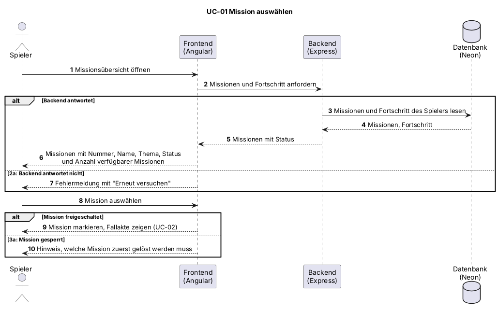

# UC-01 Mission auswählen

| Author | Estimate | User stories |
| ------ | -------- | ------------ |
| [@keckamreck](https://github.com/keckamreck) | 3 | [#12](https://github.com/MarcoDaquila/Cyber-Defenders/issues/12), [#13](https://github.com/MarcoDaquila/Cyber-Defenders/issues/13), [#15](https://github.com/MarcoDaquila/Cyber-Defenders/issues/15) |

## 1 Brief description

Der Spieler sieht alle Missionen mit ihrem Status (freigeschaltet, gesperrt, gelöst) und wählt eine freigeschaltete Mission aus, um sie zu spielen. Der Use Case ist der Einstieg in jede Mission und führt zur Fallakte und zum Editor.

## 2 Actors

- **Primary:** Spielers
- **Secondary:** keine

## 3 Mockup

## 4 Flow of events

### 4.1 Basic flow

1. Der Spieler öffnet die Missionsübersicht.
2. Das System lädt die Missionen und den Fortschritt des Spielers und zeigt jede Mission mit Nummer, Name, Thema und Status sowie die Zahl der verfügbaren Missionen an.
3. Der Spieler wählt eine freigeschaltete Mission aus.
4. Das System markiert die gewählte Mission und zeigt die Fallakte (UC-02).

### 4.2 Alternative flows

**2a · Missionen nicht ladbar.** Bei Schritt 2 antwortet das Backend nicht. Das System zeigt eine Fehlermeldung mit der Möglichkeit, es erneut zu versuchen. Der Ablauf geht bei Schritt 1 weiter.

**3a · Gesperrte Mission gewählt.** Bei Schritt 3 wählt der Spieler eine gesperrte Mission. Das System zeigt, welche Mission zuerst gelöst werden muss. Der Ablauf geht bei Schritt 3 weiter.

### 4.3 Sequence diagram

## 5 Special requirements

NFR-UC01-01: Die Missionsübersicht erscheint bei 95 % der Aufrufe innerhalb von 2 s.

## 6 Preconditions

- Der Spieler ist angemeldet.

## 7 Postconditions

- Die gewählte Mission ist markiert.
- Die Fallakte der gewählten Mission wird angezeigt.
