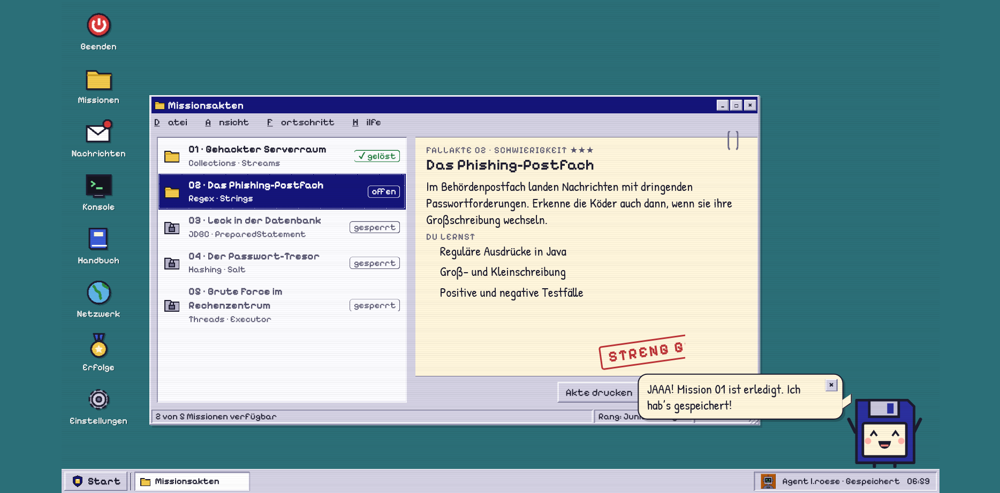
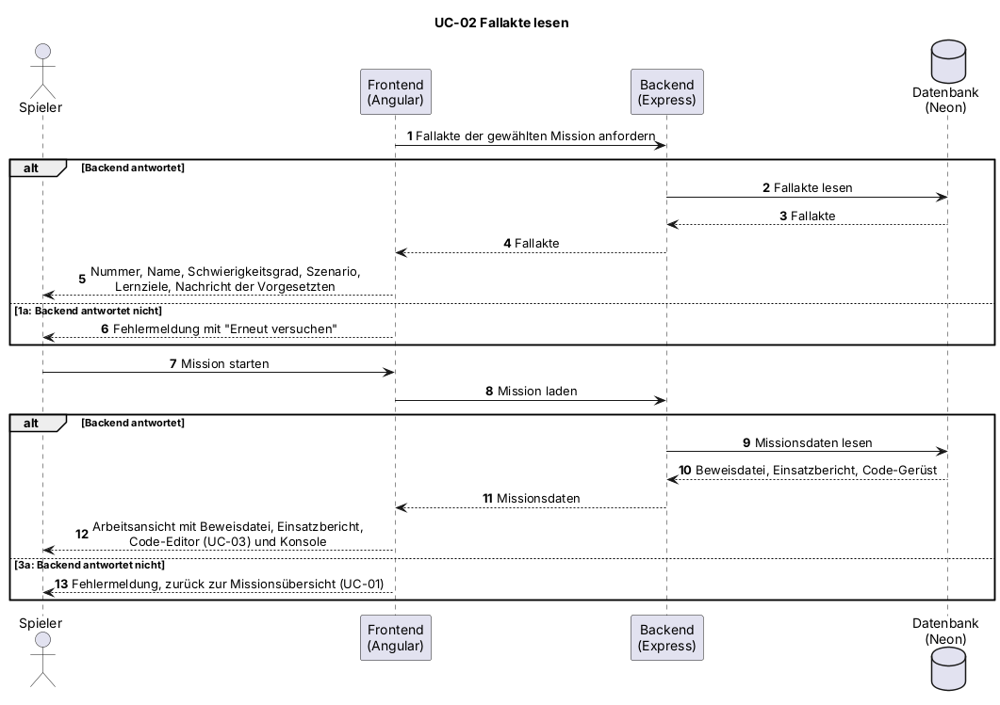

# UC-02 Fallakte lesen

| Author | Estimate | User stories |
| ------ | -------- | ------------ |
| [@MarcoDaquila](https://github.com/MarcoDaquila) | 2 | [#14](https://github.com/Cyber-Defenders-4/Cyber-Defenders/issues/14), [#17](https://github.com/Cyber-Defenders-4/Cyber-Defenders/issues/17), [#19](https://github.com/Cyber-Defenders-4/Cyber-Defenders/issues/19), [#20](https://github.com/Cyber-Defenders-4/Cyber-Defenders/issues/20), [#73](https://github.com/Cyber-Defenders-4/Cyber-Defenders/issues/73) |

## 1 Brief description

Der Spieler liest die Fallakte der gewählten Mission. Sie beschreibt das Szenario (zum Beispiel einen gehackten Serverraum), den Schwierigkeitsgrad und die Lernziele. Danach startet der Spieler die Mission, und die Arbeitsansicht mit Beweisdatei, Einsatzbericht, Code-Editor und Konsole öffnet sich.

## 2 Actors

- **Primary:** Spieler
- **Secondary:** keine

## 3 Mockup

## 4 Flow of events

### 4.1 Basic flow

1. Das System zeigt die Fallakte der gewählten Mission mit Nummer, Name, Schwierigkeitsgrad, Szenario und Lernzielen sowie eine Nachricht der Vorgesetzten zur Lage.
2. Der Spieler liest die Fallakte und startet die Mission.
3. Das System lädt die Mission und öffnet die Arbeitsansicht mit Beweisdatei, Einsatzbericht (Auftrag und Beweise), Code-Editor (UC-03) und Konsole.

### 4.2 Alternative flows

**1a · Fallakte nicht ladbar.** Bei Schritt 1 antwortet das Backend nicht. Das System zeigt eine Fehlermeldung mit der Möglichkeit, es erneut zu versuchen. Der Ablauf geht bei Schritt 1 weiter.

**3a · Mission nicht ladbar.** Bei Schritt 3 antwortet das Backend nicht. Das System zeigt eine Fehlermeldung, und der Spieler bleibt in der Missionsübersicht. Der Ablauf geht bei UC-01 weiter.

### 4.3 Sequence diagram

## 5 Special requirements

Keine.

## 6 Preconditions

- Der Spieler ist angemeldet.
- Eine offene Mission ist gewählt (UC-01).

## 7 Postconditions

- Die Mission ist gestartet.
- Die Arbeitsansicht der Mission ist geöffnet.