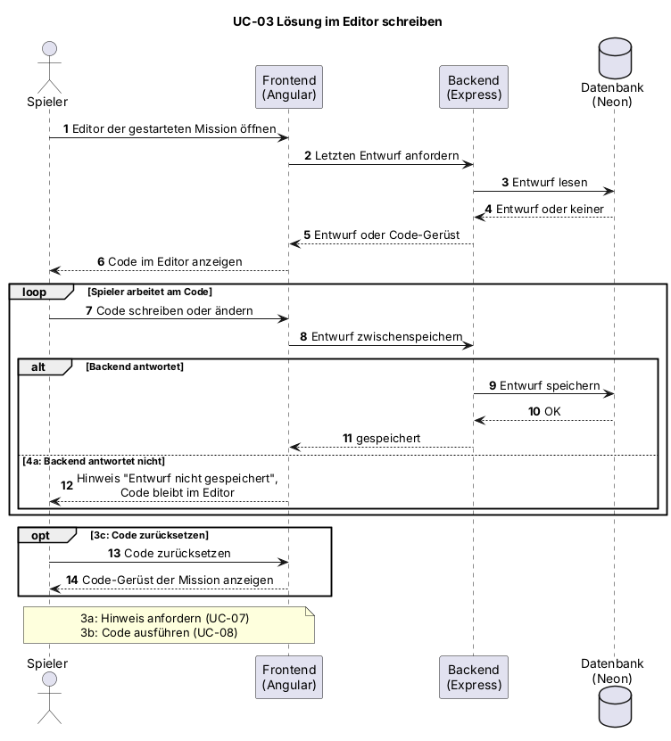

# UC-03 Lösung im Editor schreiben

| Author | Estimate | User stories |
| ------ | -------- | ------------ |
| Marco | 8 | [#22](https://github.com/MarcoDaquila/Cyber-Defenders/issues/22), [#23](https://github.com/MarcoDaquila/Cyber-Defenders/issues/23) |

## 1 Brief description

Der Spieler schreibt oder ändert Java-Code in einem Code-Editor, um die Aufgabe der Mission zu lösen. Der Editor startet mit einem vorgegebenen Code-Gerüst. Der Entwurf wird zwischengespeichert, damit nichts verloren geht.

## 2 Actors

- **Primary:** Spieler
- **Secondary:** keine

## 3 Mockup

<!-- Vorlage im Design System: Mission 01 "Gehackter Serverraum" mit Java-Editor (Design System, Mockup 3). Als PNG exportieren und unter docs/mockups/ ablegen. -->

## 4 Flow of events

### 4.1 Basic flow

1. Der Spieler öffnet den Editor der gewählten Mission.
2. Das System zeigt das Code-Gerüst der Mission oder den zuletzt gespeicherten Entwurf.
3. Der Spieler schreibt oder ändert den Code.
4. Das System speichert den Entwurf zwischen.

### 4.2 Alternative flows

**3a · Hinweis benötigt.** Bei Schritt 3 kommt der Spieler nicht weiter. Extension point: Hinweis anfordern (UC-07). Der Ablauf geht bei Schritt 3 weiter.

**4a · Entwurf nicht speicherbar.** Bei Schritt 4 antwortet das Backend nicht. Das System zeigt einen Hinweis, der Code bleibt im Editor erhalten. Der Ablauf geht bei Schritt 3 weiter.

### 4.3 Sequence diagram

## 5 Special requirements

NFR-UC03-01: Eingaben im Editor erscheinen bei 95 % der Tastenanschläge innerhalb von 100 ms.

## 6 Preconditions

- Der Spieler ist angemeldet.
- Eine Mission ist gewählt (UC-01).

## 7 Postconditions

- Der aktuelle Code-Entwurf ist gespeichert.
