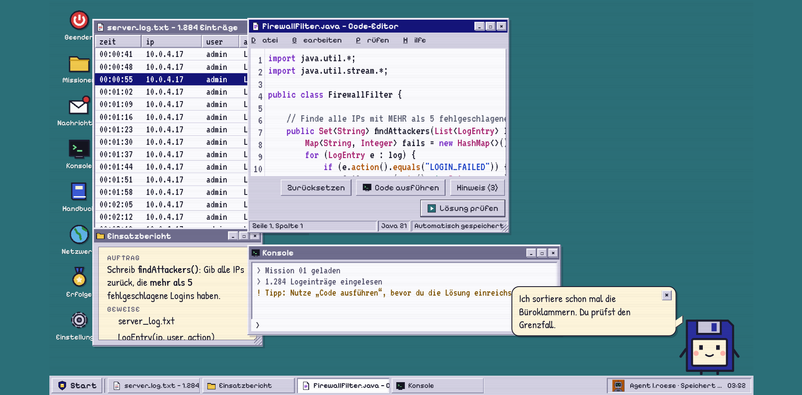
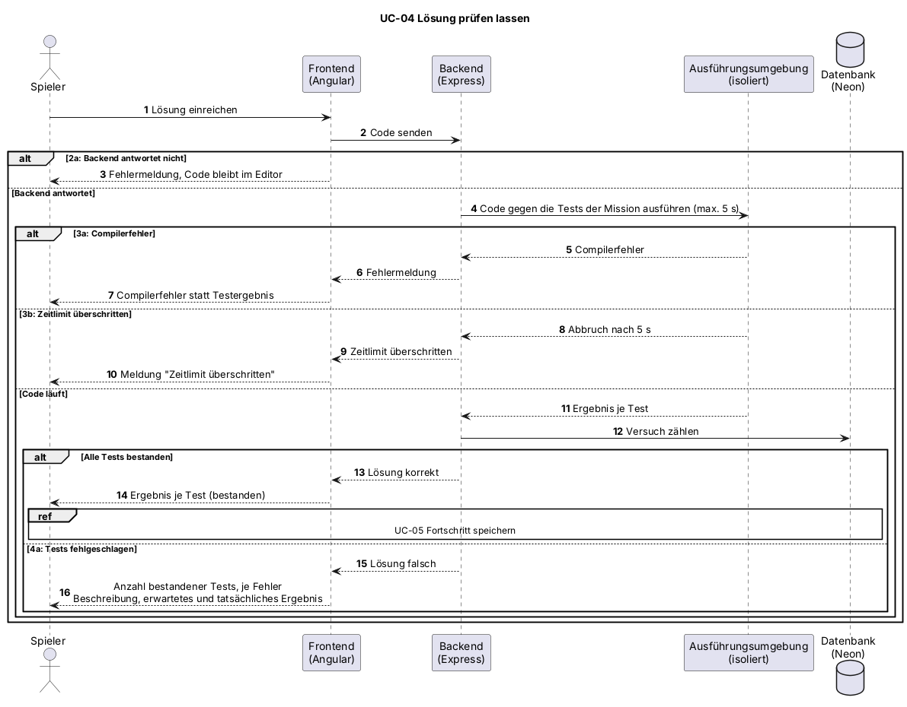

# UC-04 Lösung prüfen lassen

| Author | Estimate | User stories |
| ------ | -------- | ------------ |
| [@FelixHagino](https://github.com/FelixHagino) | 8 | [#26](https://github.com/Cyber-Defenders-4/Cyber-Defenders/issues/26), [#27](https://github.com/Cyber-Defenders-4/Cyber-Defenders/issues/27), [#28](https://github.com/Cyber-Defenders-4/Cyber-Defenders/issues/28), [#29](https://github.com/Cyber-Defenders-4/Cyber-Defenders/issues/29), technische Grundlage: Epic E10 [#71](https://github.com/Cyber-Defenders-4/Cyber-Defenders/issues/71) |

| Realization | [UCR-04 – Lösung prüfen](../use_case_realizations/UCR-04_loesung_pruefen.md) |

## 1 Brief description

Der Spieler reicht seinen Code ein, und das System prüft ihn automatisch gegen die Tests der Mission. Der Spieler erfährt für jeden Test, ob er bestanden wurde, und bekommt bei Fehlern eine Rückmeldung, woran es liegt. Ist die Lösung korrekt, schließt er die Mission ab.

## 2 Actors

- **Primary:** Spieler
- **Secondary:** keine

## 3 Mockup

## 4 Flow of events

### 4.1 Basic flow

1. Der Spieler reicht seine Lösung ein.
2. Das System sendet den Code an das Backend.
3. Das Backend führt den Code in einer isolierten Umgebung gegen die Tests der Mission aus.
4. Das System zeigt dem Spieler für jeden Test das Ergebnis (bestanden oder fehlgeschlagen) an.
5. Sind alle Tests bestanden, gilt die Lösung als korrekt, und der Abschluss der Mission wird ausgelöst. Extension point: Fortschritt speichern (UC-05).

### 4.2 Alternative flows

**2a · Backend nicht erreichbar.** Bei Schritt 2 antwortet das Backend nicht. Das System zeigt eine Fehlermeldung, der Code bleibt im Editor erhalten. Der Ablauf geht bei Schritt 1 weiter.

**3a · Code kompiliert nicht.** Bei Schritt 3 meldet die Prüfumgebung einen Compilerfehler. Das System zeigt die Fehlermeldung statt eines Testergebnisses. Der Ablauf geht bei UC-03 weiter.

**3b · Zeitlimit überschritten.** Bei Schritt 3 läuft der Code zu lange, zum Beispiel wegen einer Endlosschleife. Die Prüfumgebung bricht ab, und das System meldet das Zeitlimit statt eines Testergebnisses. Der Ablauf geht bei UC-03 weiter.

**4a · Lösung falsch.** Bei Schritt 4 schlagen Tests fehl. Das System zeigt, wie viele Tests bestanden wurden, und zu jedem fehlgeschlagenen Test eine Beschreibung sowie erwartetes und tatsächliches Ergebnis. Der Versuch wird gezählt, die Mission bleibt offen. Der Ablauf geht bei UC-03 weiter.

### 4.3 Sequence diagram

### 4.4 Activity diagram

## 5 Special requirements

NFR-UC04-01: Bei Code, der das Zeitlimit nicht erreicht, erscheint das Prüfergebnis bei 95 % der Einreichungen innerhalb von 5 s.
NFR-UC04-02: Eingereichter Code darf den Server nicht beeinträchtigen, die Ausführung ist auf 5 s Laufzeit begrenzt.

## 6 Preconditions

- Der Spieler ist angemeldet.
- Der Spieler hat einen Code-Entwurf (UC-03).

## 7 Postconditions

- Das Prüfergebnis ist angezeigt.
- Bei korrekter Lösung ist die Mission als gelöst markiert (UC-05).
- Bei falscher Lösung ist der Versuch gezählt, und die Mission bleibt offen.