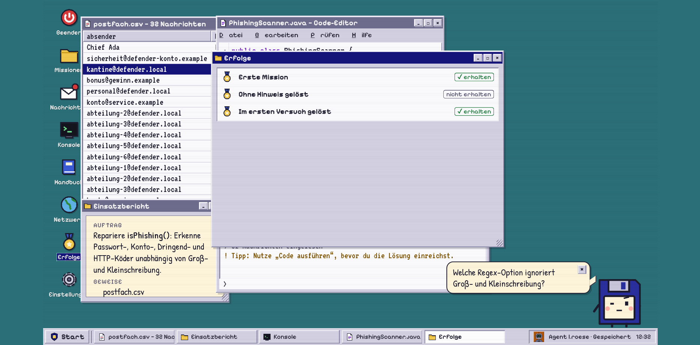
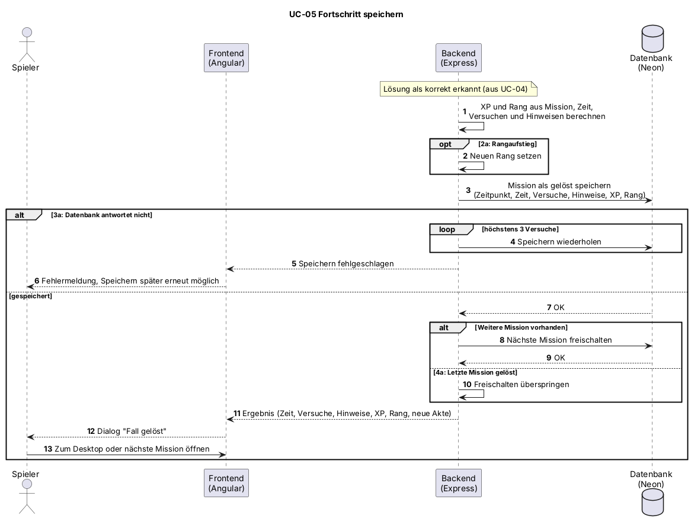

# UC-05 Fortschritt speichern

| Author | Estimate | User stories |
| ------ | -------- | ------------ |
| [@FelixHagino](https://github.com/FelixHagino) | 3 | [#30](https://github.com/Cyber-Defenders-4/Cyber-Defenders/issues/30), [#57](https://github.com/Cyber-Defenders-4/Cyber-Defenders/issues/57), [#61](https://github.com/Cyber-Defenders-4/Cyber-Defenders/issues/61), [#72](https://github.com/Cyber-Defenders-4/Cyber-Defenders/issues/72), [#75](https://github.com/Cyber-Defenders-4/Cyber-Defenders/issues/75) |

## 1 Brief description

Wurde eine Lösung als korrekt bewertet, berechnet das System XP und Rang und speichert den Fortschritt des Spielers. Die Mission gilt als gelöst, die nächste Mission wird freigeschaltet, und der Spieler sieht den Dialog "Fall gelöst". Bei der nächsten Anmeldung ist der Stand wieder da.

## 2 Actors

- **Primary:** Spieler
- **Secondary:** keine

## 3 Mockup

## 4 Flow of events

### 4.1 Basic flow

1. Das System erkennt, dass die Lösung korrekt ist (Erweiterung von UC-04).
2. Das System berechnet XP und Rang aus Mission, Zeit, Versuchen und genutzten Hinweisen.
3. Das System speichert die Mission als gelöst mit Zeitpunkt, Zeit, Versuchen, Hinweisen, XP und Rang.
4. Das System schaltet die nächste Mission frei.
5. Das System zeigt dem Spieler den Dialog "Fall gelöst" mit Zeit, Versuchen, Hinweisen, Belohnung, Rang und der neu freigeschalteten Akte.
6. Der Spieler kehrt zum Desktop zurück oder öffnet die nächste Mission.

### 4.2 Alternative flows

**2a · Rangaufstieg.** Bei Schritt 2 erreicht der Spieler die Schwelle des nächsten Rangs. Das System speichert den neuen Rang und zeigt ihn im Dialog an. Der Ablauf geht bei Schritt 3 weiter.

**3a · Speichern fehlgeschlagen.** Bei Schritt 3 antwortet die Datenbank nicht. Das System meldet den Fehler und versucht das Speichern erneut, höchstens dreimal (bitte bestätigen). Der Ablauf geht bei Schritt 3 weiter. Schlägt auch der dritte Versuch fehl, zeigt das System eine Fehlermeldung, und der Spieler kann das Speichern später erneut anstoßen. Der Use Case endet.

**4a · Letzte Mission gelöst.** Bei Schritt 4 gibt es keine weitere Mission. Das System überspringt das Freischalten, und der Dialog zeigt keine neue Akte. Der Ablauf geht bei Schritt 5 weiter.

### 4.3 Sequence diagram

### 4.4 Activity diagram

## 5 Special requirements

NFR-UC05-01: Nach einem Neuladen der Seite oder einer erneuten Anmeldung sind in 20 von 20 Testläufen alle gespeicherten Missionen, XP und der Rang unverändert vorhanden.

## 6 Preconditions

- Der Spieler ist angemeldet.
- Die Lösung wurde als korrekt bewertet (UC-04).

## 7 Postconditions

- Die Mission ist als gelöst gespeichert, XP und Rang sind aktualisiert.
- Die nächste Mission ist freigeschaltet.
- Nach der nächsten Anmeldung ist der gespeicherte Stand wieder vorhanden.