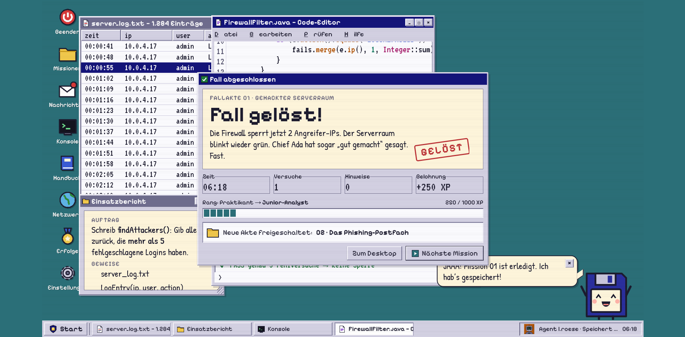
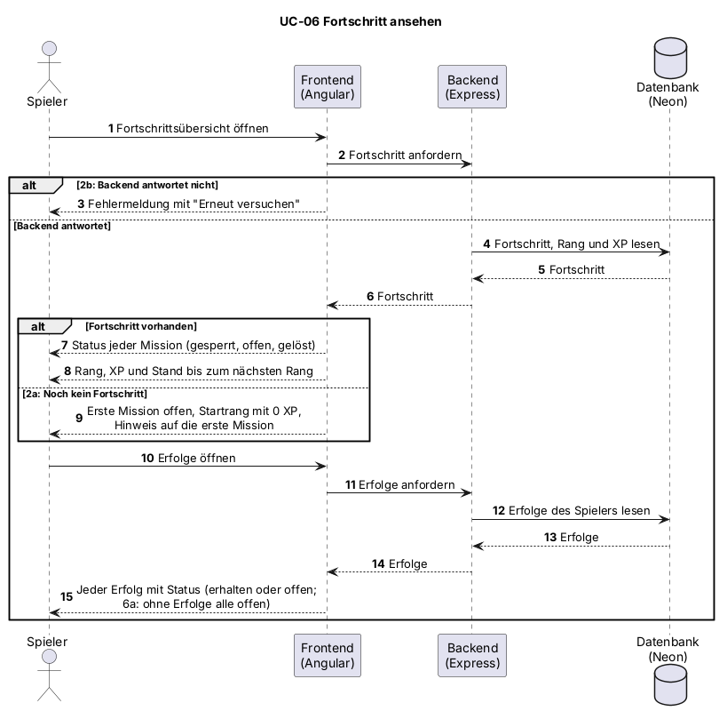

# UC-06 Fortschritt ansehen

| Author | Estimate | User stories |
| ------ | -------- | ------------ |
| [@webdesign19](https://github.com/webdesign19) | [SP im Daily schätzen] | [#58](https://github.com/Cyber-Defenders-4/Cyber-Defenders/issues/58), [#59](https://github.com/Cyber-Defenders-4/Cyber-Defenders/issues/59), [#62](https://github.com/Cyber-Defenders-4/Cyber-Defenders/issues/62) |

## 1 Brief description

Der Spieler sieht seinen Spielfortschritt: den Status jeder Mission (gesperrt, offen oder gelöst), seinen Rang mit den gesammelten XP und seine Erfolge. So behält er den Überblick und weiß, womit er weitermachen kann.

## 2 Actors

- **Primary:** Spieler
- **Secondary:** keine

## 3 Mockup

<!-- Aus dem interaktiven Figma-Design: Missionsakten mit Menü "Fortschritt" und Statusleiste (Mockup 2), Rang und XP-Balken im Dialog "Fall abgeschlossen" (Mockup 5), Fenster "Erfolge" (Mockup 6). Ein eigener Fortschritts-Screen fehlt noch. Als PNG exportieren und unter docs/mockups/ ablegen. -->

## 4 Flow of events

### 4.1 Basic flow

1. Der Spieler öffnet die Fortschrittsübersicht.
2. Das System lädt den gespeicherten Fortschritt des Spielers.
3. Das System zeigt für jede Mission den Status (gesperrt, offen oder gelöst).
4. Das System zeigt den Rang des Spielers mit seinen XP und dem Stand bis zum nächsten Rang.
5. Der Spieler öffnet seine Erfolge.
6. Das System zeigt jeden Erfolg mit seinem Status (erhalten oder noch offen).

### 4.2 Alternative flows

**2a · Noch kein Fortschritt.** Bei Schritt 2 hat der Spieler noch keine Mission gelöst. Das System zeigt nur die erste Mission als offen, den Startrang mit 0 XP und einen Hinweis auf die erste Mission. Der Ablauf geht bei Schritt 5 weiter.

**2b · Fortschritt nicht ladbar.** Bei Schritt 2 antwortet das Backend nicht. Das System zeigt eine Fehlermeldung mit der Möglichkeit, es erneut zu versuchen. Der Ablauf geht bei Schritt 1 weiter.

**6a · Noch kein Erfolg erhalten.** Bei Schritt 6 hat der Spieler noch keinen Erfolg erhalten. Das System zeigt alle Erfolge als noch offen. Der Use Case endet.

### 4.3 Sequence diagram

## 5 Special requirements

NFR-UC06-01: Die Fortschrittsübersicht erscheint bei 95 % der Aufrufe innerhalb von 2 s.

## 6 Preconditions

- Der Spieler ist angemeldet.

## 7 Postconditions

- Die Fortschrittsübersicht ist angezeigt.
- Der gespeicherte Fortschritt des Spielers ist unverändert.