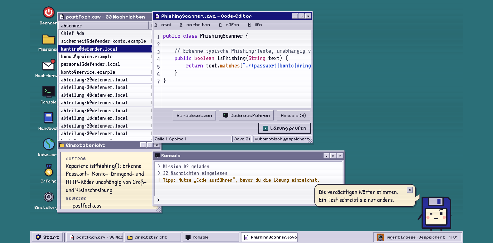

# UC-07 Hinweis anfordern

| Author | Estimate | User stories |
| ------ | -------- | ------------ |
| [@webdesign19](https://github.com/webdesign19) | 2 | [#18](https://github.com/MarcoDaquila/Cyber-Defenders/issues/18), [#63](https://github.com/MarcoDaquila/Cyber-Defenders/issues/63) |

## 1 Brief description

Kommt der Spieler bei einer Mission nicht weiter, kann er einen Hinweis anfordern. Pro Mission stehen drei Hinweise zur Verfügung. Das System zeigt den nächsten Hinweis, ohne die Lösung zu verraten, und merkt sich die Nutzung für die Auswertung der Mission.

## 2 Actors

- **Primary:** Spieler
- **Secondary:** keine

## 3 Mockup

<!-- Aus dem interaktiven Figma-Design: Code-Editor mit Button "Hinweis (3)". Der Screen mit dem angezeigten Hinweis fehlt noch. Als PNG exportieren und unter docs/mockups/ ablegen. -->

## 4 Flow of events

### 4.1 Basic flow

1. Der Spieler fordert einen Hinweis an (Erweiterung von UC-03).
2. Das System lädt den nächsten Hinweis der Mission.
3. Das System zeigt den Hinweis an und aktualisiert die Anzahl der verbleibenden Hinweise.
4. Das System speichert, dass für diese Mission ein Hinweis genutzt wurde.

### 4.2 Alternative flows

**2a · Keine Hinweise mehr.** Bei Schritt 2 sind alle Hinweise der Mission schon angezeigt worden. Das System meldet, dass es keine weiteren Hinweise gibt. Der Use Case endet.

**2b · Hinweis nicht ladbar.** Bei Schritt 2 antwortet das Backend nicht. Das System zeigt eine Fehlermeldung. Der Hinweis zählt nicht als genutzt. Der Ablauf geht bei Schritt 1 weiter.

### 4.3 Sequence diagram

## 5 Special requirements

Keine.

## 6 Preconditions

- Der Spieler ist angemeldet.
- Der Spieler hat die Mission gestartet und befindet sich im Editor (UC-03).

## 7 Postconditions

- Der Hinweis ist angezeigt.
- Die Zahl der genutzten Hinweise der Mission ist gespeichert und steht für die Auswertung der Mission zur Verfügung (UC-05, UC-06).