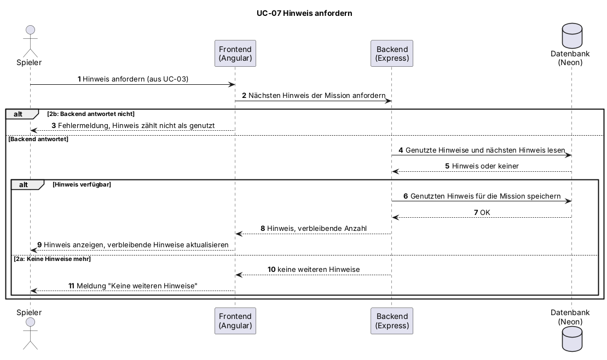

# UC-07 Hinweis anfordern

| Author | Estimate | User stories |
| ------ | -------- | ------------ |
| Leonie | 2 | [#18](https://github.com/MarcoDaquila/Cyber-Defenders/issues/18) |

## 1 Brief description

Kommt der Spieler bei einer Mission nicht weiter, kann er einen Hinweis anfordern. Das System zeigt den nächsten Hinweis der Mission, ohne die Lösung zu verraten.

## 2 Actors

- **Primary:** Spieler
- **Secondary:** keine

## 3 Mockup

<!-- Vorlage im Design System: Mission 01 mit Hinweisbereich (Design System, Mockup 3, muss ergänzt werden). Als PNG exportieren und unter docs/mockups/ ablegen. -->

## 4 Flow of events

### 4.1 Basic flow

1. Der Spieler fordert einen Hinweis an (Erweiterung von UC-03).
2. Das System lädt den nächsten Hinweis der Mission.
3. Das System zeigt den Hinweis an.

### 4.2 Alternative flows

**2a · Keine Hinweise mehr.** Bei Schritt 2 sind alle Hinweise der Mission schon angezeigt worden. Das System meldet, dass es keine weiteren Hinweise gibt. Der Use Case endet.

**2b · Hinweis nicht ladbar.** Bei Schritt 2 antwortet das Backend nicht. Das System zeigt eine Fehlermeldung. Der Ablauf geht bei Schritt 1 weiter.

### 4.3 Sequence diagram

## 5 Special requirements

Keine.

## 6 Preconditions

- Der Spieler ist angemeldet.
- Der Spieler ist im Editor einer Mission (UC-03).

## 7 Postconditions

- Der Hinweis ist angezeigt.
