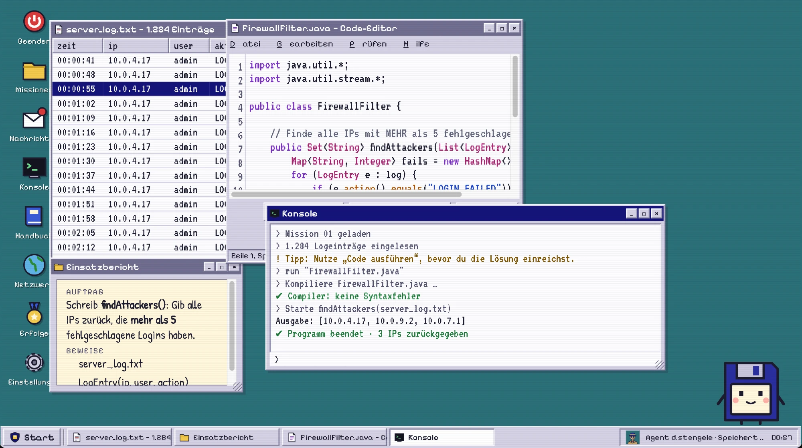
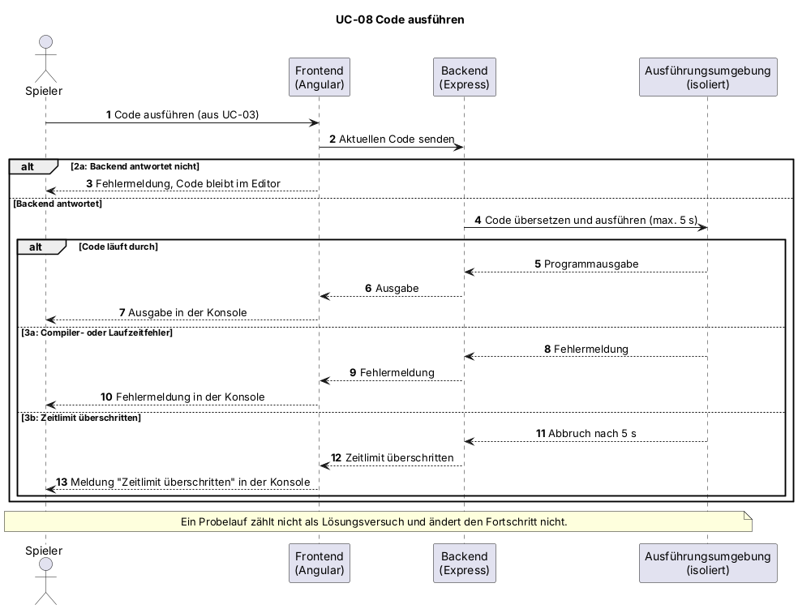

# UC-08 Code ausführen

| Author | Estimate | User stories |
| ------ | -------- | ------------ |
| [@webdesign19](https://github.com/webdesign19) | 5 | [#24](https://github.com/Cyber-Defenders-4/Cyber-Defenders/issues/24), technische Grundlage: Epic E10 [#71](https://github.com/Cyber-Defenders-4/Cyber-Defenders/issues/71) |

| Realization | [UCR-08 – Fortschritt ansehen](../use_case_realizations/UCR-08_code_ausfuehren.md) |

## 1 Brief description

Der Spieler führt den Java-Code aus dem Editor zur Probe aus und sieht die Ausgabe oder Fehlermeldungen in der Konsole. So kann er seinen Ansatz ausprobieren, bevor er die Lösung zur Prüfung einreicht. Ein Probelauf wird nicht bewertet.

## 2 Actors

- **Primary:** Spieler
- **Secondary:** keine

## 3 Mockup

## 4 Flow of events

### 4.1 Basic flow

1. Der Spieler führt seinen Code aus (Erweiterung von UC-03).
2. Das System sendet den aktuellen Code an das Backend.
3. Das Backend übersetzt und führt den Code in einer isolierten Umgebung aus.
4. Das System zeigt die Ausgabe des Programms in der Konsole an.

### 4.2 Alternative flows

**2a · Backend nicht erreichbar.** Bei Schritt 2 antwortet das Backend nicht. Das System zeigt eine Fehlermeldung, der Code bleibt im Editor erhalten. Der Ablauf geht bei Schritt 1 weiter.

**3a · Code kompiliert nicht oder bricht ab.** Bei Schritt 3 meldet die Umgebung einen Compiler- oder Laufzeitfehler. Das System zeigt die Fehlermeldung in der Konsole. Der Use Case endet.

**3b · Zeitlimit überschritten.** Bei Schritt 3 läuft der Code zu lange, zum Beispiel wegen einer Endlosschleife. Die Umgebung bricht die Ausführung ab, und das System meldet das Zeitlimit in der Konsole. Der Use Case endet.

### 4.3 Sequence diagram

### 4.4 Activity diagram

## 5 Special requirements

NFR-UC08-01: Bei Code, der das Zeitlimit nicht erreicht, erscheint die Ausgabe eines Probelaufs bei 95 % der Läufe innerhalb von 3 s.
NFR-UC08-02: Die Ausführung ist auf 5 s Laufzeit begrenzt (gleiche Grenze wie NFR-UC04-02).

## 6 Preconditions

- Der Spieler ist angemeldet.
- Der Spieler hat die Mission gestartet und befindet sich im Editor (UC-03).

## 7 Postconditions

- Die Ausgabe oder die Fehlermeldung ist in der Konsole angezeigt.
- Der Probelauf zählt nicht als Lösungsversuch und ändert den Fortschritt nicht.